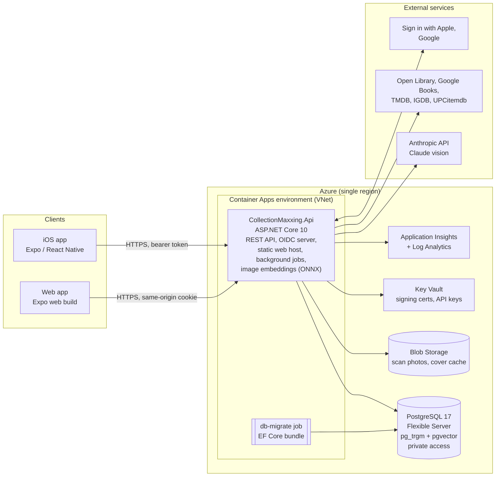
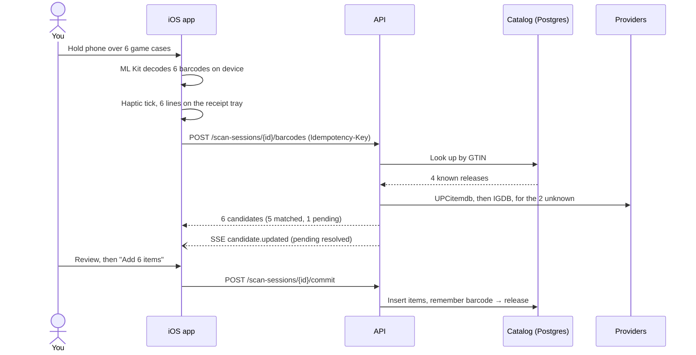
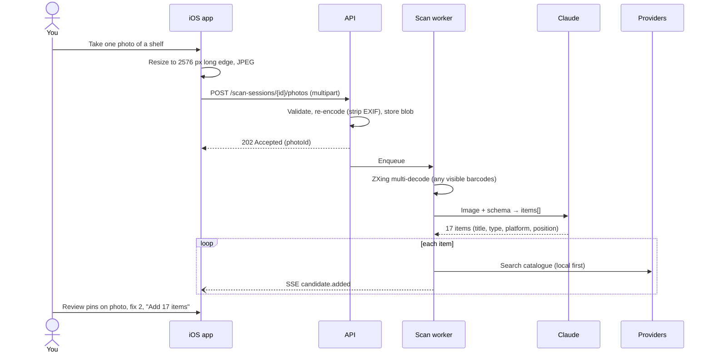

# 01 — Architecture

## Principles

1. **Boring, trusted core.** .NET 10 LTS, PostgreSQL, standard OAuth/OIDC. No novel infrastructure where a table and a background service will do.
2. **One deployable backend.** A modular monolith: one container serves the REST API, the OIDC endpoints, the web app's static files and background jobs. Split only when there's a measured reason.
3. **The scanner never waits on the network.** Barcodes decode on the device. Identification happens server-side and streams back.
4. **External data is untrusted.** Provider APIs and the LLM are adapters behind interfaces. Their output is validated, cached and never trusted for authorization or rendering as HTML.
5. **Testability is a design input.** Every I/O boundary is an interface with a fake. Time is injected (`TimeProvider`). See [09](09-testing-and-tdd.md).
6. **Passwordless and keyless where possible.** Users have no passwords. The services use managed identity instead of connection-string secrets.

## System context



The web app is served **from the same origin as the API**. That lets the browser use an HttpOnly session cookie, so no tokens live in JavaScript, and it removes CORS entirely. The iOS app uses standard OAuth 2.0 Authorization Code + PKCE and gets bearer tokens. See [07](07-authentication-and-authorization.md).

## Technology stack

### Backend

| Concern | Choice | Notes |
|---|---|---|
| Runtime | **.NET 10 (LTS)** | Supported to Nov 2028. .NET 11 (Nov 2026) is STS, so skip it. |
| Web | ASP.NET Core Minimal APIs, route groups per feature | Built-in .NET 10 validation (`AddValidation`), `TypedResults`, SSE results |
| Data | **PostgreSQL 17**, EF Core 10 + Npgsql | `pg_trgm` for fuzzy title search/matching; `jsonb` for raw provider payloads |
| Identity | ASP.NET Core Identity + **OpenIddict 7** | Passkeys (new in .NET 10 Identity); Apple/Google through OpenIddict's web providers |
| Background work | `BackgroundService` + a Postgres job table (`FOR UPDATE SKIP LOCKED`) | Durable, multi-replica safe, no extra infrastructure |
| HTTP resilience | `Microsoft.Extensions.Http.Resilience` | Retry with jitter that honours `Retry-After`, timeouts, circuit breakers, per-provider rate limiters |
| Caching | `HybridCache` (memory) + `provider_cache` table (durable) | Provider responses are cached to respect quotas |
| AI | Official **Anthropic C# SDK** (`Anthropic` NuGet), `claude-opus-5-5` | Structured outputs; see [02](02-scanning-and-recognition.md) |
| Visual matching | **ONNX Runtime** (`Microsoft.ML.OnnxRuntime`) running an int8 image-embedding model (SigLIP 2 / CLIP, chosen by evals) in-process + **pgvector** (`Pgvector.EntityFrameworkCore`) | Recognises covers and cartridges by artwork; free and private, with no third party. See [02 §5](02-scanning-and-recognition.md#5-cover-recognition-identify-one-item-from-its-picture). |
| Images | SixLabors.ImageSharp | Validate, auto-orient, re-encode (strips EXIF/GPS), thumbnails. Its Split License is free at our scale; revisit if this ever goes commercial. |
| Barcodes (server) | ZXing.Net | Multi-barcode decode on uploaded stills |
| API docs | `Microsoft.AspNetCore.OpenApi` (OpenAPI 3.1) + Scalar UI (development only) | The TypeScript client is generated from this document |
| Observability | OpenTelemetry → Azure Monitor | Traces, metrics, logs; one trace across app → API → providers |
| Local orchestration | **Aspire** AppHost | One F5 starts Postgres, Azurite, the API and the Expo web dev server |
| Packages | Central Package Management, `TreatWarningsAsErrors`, nullable enabled, `.editorconfig` | |

We deliberately avoid **MediatR and AutoMapper**. Both moved to commercial licensing in 2025, and we don't need them: handlers are plain classes injected into endpoints, and mapping is explicit. The same goes for **FluentAssertions** (v8 is commercial); we use Shouldly instead.

### Front end (details in [05](05-frontend.md))

Expo SDK 57 (React Native 0.86, React 19.2), TypeScript, Expo Router, TanStack Query, Zustand, VisionCamera v5 + its ML Kit barcode scanner, a client generated with orval from OpenAPI, and EAS Build/Submit/Update.

## Solution structure

```
src/
  CollectionMaxxing.AppHost/          Aspire orchestration (dev only)
  CollectionMaxxing.ServiceDefaults/  OTel, health checks, resilience defaults
  CollectionMaxxing.Domain/           Entities, value objects, domain services. No dependencies.
  CollectionMaxxing.Application/      Use-case handlers, ports (interfaces), DTOs
  CollectionMaxxing.Infrastructure/   EF Core, provider clients, Claude client, blob, image, ZXing, ONNX image embedder
  CollectionMaxxing.Api/              Composition root: endpoints, auth, OpenIddict, login pages, SPA host
tests/
  CollectionMaxxing.Domain.Tests/
  CollectionMaxxing.Application.Tests/
  CollectionMaxxing.Infrastructure.Tests/   Testcontainers Postgres, WireMock providers
  CollectionMaxxing.Api.Tests/              WebApplicationFactory: acceptance + authorization matrix
  CollectionMaxxing.Architecture.Tests/     Layering rules
  CollectionMaxxing.Recognition.Evals/      Opt-in; real Claude calls on golden photos
app/                                        Expo app (iOS + web)
infra/                                      Bicep
```

### Dependency rules (enforced by `Architecture.Tests`)

```
Api ──► Application ──► Domain
 │            ▲
 └──► Infrastructure ──┘   (Infrastructure implements Application's ports)
```

- **Domain** references nothing except the BCL: no EF, no ASP.NET, no HTTP.
- **Application** references Domain only. It defines ports such as `ICatalogProvider`, `IVisionIdentifier`, `IBlobStore`, `IAppDbContext` and `IClock`.
- **Infrastructure** implements the ports. It is the only project that touches the network, the database driver or the file system.
- **Api** wires everything, owns the HTTP and auth concerns, and contains no business rules.
- Endpoint classes may not reference `DbContext` directly; they call application handlers.

### Feature slices inside Application

Code is organised by feature (vertical slice), not by technical layer:

```
Application/
  Library/      AddItem, UpdateItem, DeleteItem, ListItems, GetItem, MoveItems
  Scanning/     StartSession, SubmitBarcodes, SubmitPhoto, ResolveCandidate, CommitSession
  Catalog/      SearchCatalog, LookupIdentifier, RefreshRelease
  Ownership/    CheckOwnership
  Locations/    …
  Accounts/     DeleteAccount, ExportLibrary
```

Each use case is one handler class with one public method, a request record and a response record. For example: `SubmitBarcodes.Handler.HandleAsync(SubmitBarcodes.Command, CancellationToken)`.

## Key runtime flows

### Live barcode batch



### Shelf photo



### Picture of one item (no barcode in view)

```mermaid
sequenceDiagram
  actor U as You
  participant App as iOS app
  participant API as API
  participant Job as Scan worker
  participant V as Visual index<br/>(ONNX + pgvector)
  participant C as Claude
  participant P as Providers
  U->>App: Hold up a loose N64 cart
  App->>App: No barcode, steady, title text → auto-snap, receipt line "IDENTIFYING…"
  App->>API: POST /scan-sessions/{id}/photos
  API-->>App: 202 (photoId)
  U->>App: Point at the next cart (pipelined)
  API->>Job: Enqueue
  Job->>Job: ZXing (no barcode found)
  Job->>V: Fast path? (no confirmed photo of yours matches)
  Job->>C: Photo → items[]: one cartridge, title, platform, completeness, region
  Job->>V: Embed item crop → nearest artwork (top 20)
  Job->>P: Search IGDB "Super Mario 64" / N64 → fetch + embed artwork
  Job->>Job: Rerank (cartridge profile); margin OK → no tie-break call
  Job--)App: SSE candidate.updated → "SUPER MARIO 64 · N64 · READY"
```

## Cross-cutting concerns

| Concern | Approach |
|---|---|
| Errors | RFC 9457 Problem Details everywhere; no stack traces outside development |
| Validation | Request DTOs are validated at the edge. Domain invariants are enforced in constructors and methods, and are never bypassed by EF. |
| Time | `TimeProvider` injected; tests use `FakeTimeProvider` |
| IDs | UUIDv7 (`Guid.CreateVersion7()`): time-ordered for index locality |
| Concurrency | Optimistic, using Postgres `xmin` as the row version and exposed as an `ETag` |
| Idempotency | `Idempotency-Key` on create/commit endpoints. Responses are stored for 24 h, so mobile retries are safe. |
| Configuration | Options pattern with validation at startup (`ValidateOnStart`); secrets come only from Key Vault or user-secrets |
| Feature flags | `Microsoft.FeatureManagement` backed by config. Used for AI scanning and new providers. |
| Logging | Structured logs with no PII or tokens. A user ID is fine; an email is not. |
| Health | `/health/live`, `/health/ready` (DB + blob); a minimal readiness check for the external providers |

## Why not microservices, serverless functions or a separate worker?

One person builds this, and the traffic is a single household's. A second deployable doubles CI/CD, auth wiring and failure modes for no benefit. The scan worker is a `BackgroundService` in the same process. The job table makes it safe to run several replicas. If AI scanning ever needs independent scaling, the worker project can move into its own Container App without code changes, because it talks only to the job table and the ports.
