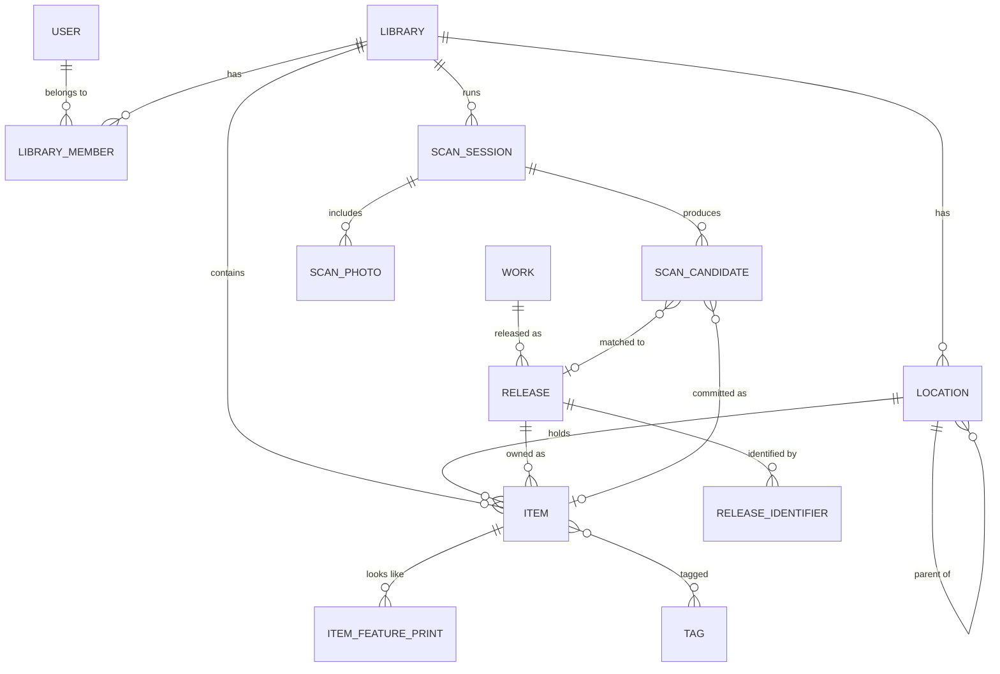

# 03 — Data model

PostgreSQL 17 with EF Core 10 (Npgsql). Tables use snake_case, IDs are UUIDv7, and timestamps are `timestamptz` in UTC.

## The core idea: Work → Release → Item

- **Work** is the creative thing: *Jurassic Park*, the novel; *Jurassic Park*, the film; *Super Mario 64*.
- **Release** is a specific physical product you can hold, usually with a barcode: the 1993 VHS, the 2000 DVD, the 4K UHD; the N64 cartridge; the Knopf first-edition hardcover.
- **Item** is *your copy* of a release: its condition, where it lives, whether it's lent out.

This split is what makes these possible:

- "You own *The Matrix* on VHS. This is the DVD." Same work, different release.
- Catalogue data is shared and cached once across all users, while your copy data stays private.
- Fixing a wrong match swaps the release and keeps your copy data.

## Entity-relationship diagram

## Tables

### Identity and tenancy

| Table | Key columns | Notes |
|---|---|---|
| `users` (ASP.NET Identity) | `id`, `display_name`, `email` (nullable; may be an Apple private relay address), `created_at`, `deleted_at` | No password hash column is ever populated (passwordless) |
| `user_passkeys` (Identity) | credential id + public key + name | WebAuthn credentials (no external login providers) |
| `device_pairings` | `id`, `user_id`, `token_hash`, `code_hash` (6-digit fallback), `expires_at` (2 min), `used_at`, `attempts`, `device_name`, `authorization_id` | Single use; the plaintext token only ever appears in the QR code |
| `setup_codes` | `id`, `purpose` (`setup`/`recovery`), `code_hash`, `expires_at`, `used_at` | Setup works only while there's no owner; recovery codes come from the PC CLI |
| OpenIddict tables | applications, authorizations, scopes, tokens | Managed by OpenIddict's EF stores |
| `libraries` | `id`, `name`, `created_at` | Every user gets a personal library at sign-up |
| `library_members` | `library_id`, `user_id`, `role` (`owner`/`editor`/`viewer`), `joined_at` | PK (`library_id`, `user_id`). Exactly one owner per library. |
| `library_invites` (v1.1) | `id`, `library_id`, `role`, `token_hash`, `expires_at`, `accepted_by` | Only the hash of the token is stored |

### Catalogue (shared)

| Table | Key columns | Notes |
|---|---|---|
| `works` | `id`, `kind` (`book`/`film`/`tv`/`game`/`other`), `title`, `sort_title`, `normalized_title`, `original_year`, `creators jsonb`, `genres text[]`, `synopsis`, `external_ids jsonb` (`{tmdb, igdb, openlibrary_work}`), `cover_asset_id` | GIN trigram index on `normalized_title` |
| `releases` | `id`, `work_id`, `format` (see below), `platform` (games), `region` (`ntsc_u`/`pal`/`ntsc_j`/`region_free`), `edition` text, `publisher`, `release_date`, `page_count`, `runtime_minutes`, `cover_asset_id`, `source` (`provider`/`user`/`ai`), `owner_library_id` (null = global), `provider_payloads jsonb`, `refreshed_at` | A user-created release is visible only to its library until it's verified |
| `release_identifiers` | `release_id`, `type` (`isbn13`/`gtin13`/`gtin8`/`asin`), `value` | Unique (`type`, `value`, `release_id`); index (`type`, `value`). One barcode can occasionally map to more than one release (reused UPCs), so it is not unique on its own. |
| `assets` | `id`, `kind` (`cover`/`scan_photo`/`user_photo`), `blob_path`, `content_type`, `width`, `height`, `sha256`, `source_url`, `owner_library_id` | Covers are fetched once from allow-listed hosts and served by us |
| `provider_cache` | `provider`, `key`, `payload jsonb`, `fetched_at`, `expires_at` | PK (`provider`, `key`) |
| `provider_quota` | `provider`, `day`, `used`, `limit` | UPCitemdb's daily cap |
| `item_feature_prints` | `id`, `library_id`, `item_id`, `release_id`, `revision` (Apple feature-print revision), `data bytea` (opaque), `created_at` | **Backup and sync only.** Apple feature prints are computed and compared on the phone; the server never reads them. Lets a new phone restore instant matching. |

**`format` values:** `hardcover`, `paperback`, `mass_market`, `vhs`, `betamax`, `laserdisc`, `dvd`, `bluray`, `uhd_bluray`, `game_cartridge`, `game_disc`, `game_card`, `other`.

**`platform`:** a reference table (`platforms`: `id`, `name`, `short_name`, `manufacturer`, `igdb_id`) seeded from IGDB. Examples: NES, SNES, N64, GameCube, Wii, Switch, PS1–PS5, Xbox family, GB/GBC/GBA, DS/3DS, PC, Sega Genesis, Saturn, Dreamcast, …

### Your stuff (library-scoped)

| Table | Key columns | Notes |
|---|---|---|
| `items` | `id`, `library_id`, `release_id`, `status` (`owned`/`wishlist`/`lent`/`sold`/`missing`), `condition` (`sealed`/`mint`/`very_good`/`good`/`fair`/`poor`), `completeness` (`complete`/`disc_only`/`cart_only`/`box_only`/`no_manual`/`n_a`), `location_id`, `notes`, `acquired_on`, `lent_to`, `lent_on`, `custom_title`, `custom_cover_asset_id` (your photo), `cover_choice` (`release`/`my_photo`; loose carts default to `my_photo`), `added_via` (`barcode`/`picture`/`search`/`import`/`manual`), `created_at`, `created_by`, `updated_at`, `deleted_at`, `xmin` (concurrency) | Indexes: (`library_id`, `status`), (`library_id`, `release_id`), (`library_id`, `created_at` desc). Soft delete with a 30-day "Recently deleted" bin. |
| `locations` | `id`, `library_id`, `parent_id`, `name`, `sort_order` | A tree: Room › Shelf › Bin |
| `tags`, `item_tags` | `id`, `library_id`, `name` / (`item_id`, `tag_id`) | |

### Scanning

| Table | Key columns | Notes |
|---|---|---|
| `scan_sessions` | `id`, `library_id`, `user_id`, `status` (`open`/`committed`/`abandoned`), `default_location_id`, `default_status`, `created_at`, `committed_at` | Sessions abandoned after 7 days are cleaned up |
| `scan_snaps` | `id`, `session_id`, `trigger` (`auto`/`shutter`/`import`), `engine` (`apple_model`/`vision_pipeline`), `fell_back` (bool, with the reason: unavailable/declined/context), `item_count`, `asset_id` (null unless the photo was uploaded: "Use my photo"), `created_at` | Metadata only; the photo itself stays on the phone |
| `scan_candidates` | `id`, `session_id`, `seq`, `source` (`barcode`/`picture_apple_model`/`picture_text`/`search`), `raw_code`, `symbology`, `visible_text` (what the phone read), `snap_id`, `local_id` (the phone's id for the item, so it can draw the box), `box` (x, y, w, h normalised 0–1), `box_source` (`ocr`/`rect`), `resolution` (`pending`/`matched`/`ambiguous`/`not_found`/`error`), `matched_release_id`, `score`, `art_distance` (feature-print distance reported by the phone, close calls only), `inferred jsonb` (completeness, region, edition marks, box/manual visible),  `alternatives jsonb`, `trace jsonb`, `decision` (`undecided`/`accepted`/`rejected`), `copies int`, `already_owned_count`, `created_item_id`, `idempotency_key` | Unique (`session_id`, `idempotency_key`) |
| `jobs` | `id`, `type`, `payload jsonb`, `status`, `attempts`, `run_after`, `locked_by`, `locked_until`, `last_error` | Polled with `FOR UPDATE SKIP LOCKED` |

### Operations

| Table | Purpose |
|---|---|
| `match_feedback` | Which alternative the user picked versus what we ranked first. Feeds the evals. |
| `audit_events` | `id`, `actor_user_id`, `library_id`, `action`, `entity_type`, `entity_id`, `at`, `ip_hash`, `details jsonb`. Security-relevant and destructive actions. |
| `idempotency_keys` | `user_id`, `key`, `request_hash`, `response_status`, `response_body`, `expires_at` |

## Tenancy and isolation

- Every library-scoped table has `library_id`. Every query against it is filtered by the caller's memberships. This happens in **two independent places**:
  1. **Endpoint authorization:** resource-based policy checks membership and role before the handler runs. See [07](07-authentication-and-authorization.md).
  2. **EF Core global query filter** on library-scoped entities, using the request's `ICurrentUser.LibraryIds`. This is defence in depth, so a forgotten `Where` can't leak data.
- Integration tests prove the isolation: two users and two libraries, with every read path tried across the boundary.
- Catalogue tables are readable by any authenticated user, except releases with `owner_library_id` set, which are filtered the same way.

## Search

- **Library search** (your items): `pg_trgm` similarity on `works.normalized_title` + `items.custom_title`, combined with structured filters. Thousands of rows per library is trivial.
- **Catalogue search** (adding new things): the local catalogue first, using the same trigram index, then providers.
- Full-text search (`tsvector`) is a v2 consideration for notes and synopsis.
- Extensions: `pg_trgm`, enabled by a migration (`CREATE EXTENSION IF NOT EXISTS pg_trgm`). No vector database: artwork comparison happens on the phone.

## Migrations

- EF Core migrations, one per PR that changes the model. Reviewed like code.
- **Expand/contract only.** Never rename or drop in one step. That keeps a rollback to the previous image safe (see [10](10-hosting-and-devops.md)).
- Deployed by an **EF migration bundle** (`efbundle`) running as the one-shot `migrate` compose service *before* the API restarts.
- CI applies every migration from an empty database in Testcontainers, and checks that the model snapshot has no pending changes.

## Data lifecycle

| Data | Retention |
|---|---|
| Items | Until you delete them; soft-deleted for 30 days, then purged |
| Scan photos | Stay on your phone and are cleared from its cache after Review. Uploaded only for "Use my photo" covers (kept with the item, on your PC). |
| Abandoned scan sessions | 7 days |
| Feature prints of your items | On the phone, plus an opaque backup on the server, as long as the item exists; deleted with the item or the account |
| Provider cache | 30 days (re-fetched on demand) |
| Audit events | 1 year |
| Deleted account | Library data purged within 30 days; audit entries anonymized |
