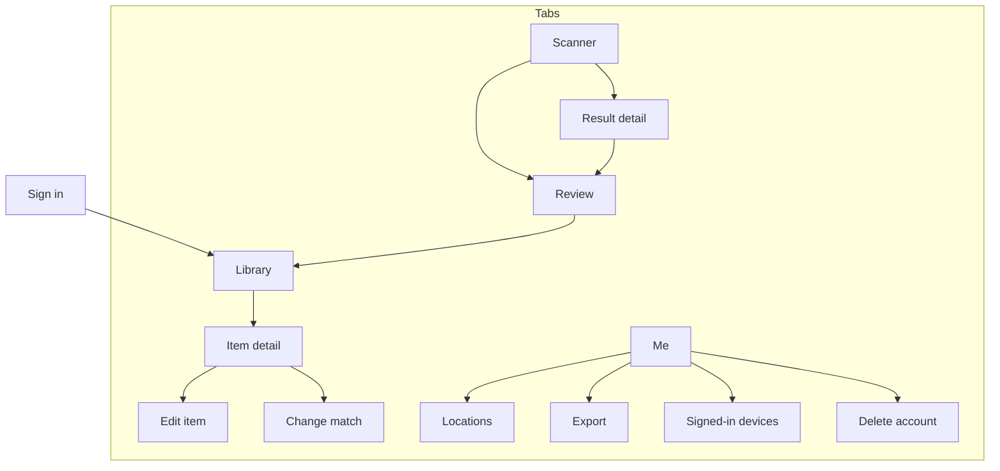

# 06 — UX and wireframes

High-fi mockups and low-fi wireframes are on the design canvas: <https://claude.ai/artifact/FBBMc4KUa33nCXaHLpCZhe>.
This doc holds the same screens as ASCII wireframes plus the interaction rules behind them. These rules are what the implementation and tests follow.

## UX principles

1. **One scanner, no modes.** Scan is the centre tab. You point the camera at barcodes, a single cart or sleeve, or a whole shelf, and it works out which it's looking at. There's nothing to pick. Later it can also be an iOS Control Center button and an Action Button shortcut.
2. **Never block on the network.** Codes appear on the receipt the instant they're decoded. Titles fill in as they resolve.
3. **Review before commit, but make the happy path one tap.** If everything matched, the button just says **Add 12 items**.
4. **Duplicates are surfaced, never silently added.**
5. **One-handed and basement-proof.** Controls are bottom-anchored, the torch is one tap, and haptics and sound confirm every scan.
6. **Covers are the interface.** Minimal chrome; the art carries the screen.
7. **Plain words.** Sentence case and verbs that say what happens. The button that says **Add 12 items** produces a toast that says **Added 12 items**.

## Visual direction (used by the mockups)

**Concept: the shelf and the receipt.** The library is drawn as shelves: covers keep their real proportions and sit on a common baseline, so a VHS clamshell stands taller than a paperback and an N64 cartridge is wider than tall. Scanning borrows the checkout counter: every barcode prints a line onto a **receipt tray** that grows at the bottom of the scanner. That receipt is the one bold element. Everything else stays quiet so the cover art can be loud.

| Token | Value | Use |
|---|---|---|
| `ground` | `#F3F4F6` | App background |
| `surface` | `#FFFFFF` | Sheets, cards, table |
| `ink` | `#1A1C22` | Primary text |
| `muted` | `#5E6472` | Secondary text (5.9:1 on white) |
| `line` | `#DADDE3` | Dividers, shelf baselines |
| `scan` | `#2348D8` | Primary actions, matched state |
| `sticker` | `#F26B1D` (fill) / `#B9480A` (text) | Needs attention: ambiguous, already owned |
| `laser` | `#FF2D3A` | Live scan line only |
| `receipt` | `#FBFBF7` | Receipt tray paper |

**Type:** *Archivo* (variable width). The condensed bold cut is for titles and headings, a nod to spine lettering; the normal width is for body text. *IBM Plex Mono* is used **only** inside the receipt tray.

**States:** each is distinguished by colour **and** icon **and** word, never colour alone:
matched = blue + check + "Ready"; needs a pick = orange + split arrow + "Pick one"; not found = grey outline + question mark + "Not found"; already owned = orange sticker + "You own 1".

## Navigation map



**iOS tabs:** Library · **Scan** (centre, larger) · Me.
**Web sidebar:** Library · Scan photos · Wishlist · Lent out · Locations · Import / export · Settings.

---

## iOS screens

### M1 · Sign in

```
┌──────────────────────────────────────┐
│                                      │
│  CollectionMaxxing                   │
│  Catalogue your shelves by pointing  │
│  your phone at them.                 │
│                                      │
│      [ shelf illustration of         │
│        covers on a baseline ]        │
│                                      │
│ ┌──────────────────────────────────┐ │
│ │       Continue with Apple        │ │
│ └──────────────────────────────────┘ │
│ ┌──────────────────────────────────┐ │
│ │       Continue with Google       │ │  (v1.1)
│ └──────────────────────────────────┘ │
│  Terms · Privacy                     │
└──────────────────────────────────────┘
```

- Opens the system auth sheet (ASWebAuthenticationSession). On iOS, Apple sign-in shows the native Face ID sheet inside it.
- First sign-in creates your library. There's no onboarding carousel: the first screen after sign-in is the empty Library with one button, **Scan your first shelf**.

### M2 · Library

```
┌──────────────────────────────────────┐
│ Library                      ⇅  ⋯    │
│ ┌──────────────────────────────────┐ │
│ │ ⌕  Search 1,284 items            │ │
│ └──────────────────────────────────┘ │
│ (All) (Games 412) (Movies 538) (Bo…  │
│  Owned ▾    Any location ▾           │
│                                      │
│            ┌────┐                    │
│  ┌────┐    │VHS │   ┌──────┐         │
│  │book│    │    │   │ N64  │         │
│  │    │    │    │   │ cart │         │
│ ═╧════╧════╧════╧═══╧══════╧══════   │  ← shelf baseline
│  Dune       Back to   Super Mario    │
│  Paperback  the Future N64           │
│             VHS                      │
│                                      │
│  (next shelf row…)                   │
├──────────────────────────────────────┤
│   Library      (  Scan  )      Me    │
└──────────────────────────────────────┘
```

- The filter chips scroll horizontally, and their counts update live. Long-press a cover for quick actions: move, lend, delete.
- Sort: recently added (default), title, year, platform.
- **Empty state:** "Nothing here yet. Point your camera at a shelf or a stack of cases." [Scan your first shelf]

### M3 · Scanner (one screen for everything)

```
┌──────────────────────────────────────┐
│ ⌂        ( Seeing: shelf )     Torch │
│  ┌                              ┐    │
│    ▌▌▐▌▌▐▐▌▌▌▐▌▐▌▌▌▐▌▌▌▐▌▌▐▌▌▐▌      │  ← live camera: barcodes read on
│    ▌▌▐▌▌▐▐▌▌▌▐▌▐▌▌▌▐▌▌▌▐▌▌▐▌▌▐▌      │     sight; pictures snap when steady
│            ( ✓ Nice scan! )          │  ← instant confirmation
│  └                              ┘    │
│ ┌──────────┐ ┌──────────┐ ┌────────  │  ← result cards, newest first,
│ │ Dune     │ │ Mario 64 │ │ Ghostbu  │     swipe through; tap for detail
│ │ Paperbk  │ │ N64 cart │ │ VHS      │
│ │ You own 1│ │ + Add    │ │ + Add    │
│ └──────────┘ └──────────┘ └────────  │
│   Photos       ( ◯ )        Torch    │  ← import from Photos · shutter
│ ──────────────────────────────────── │
│ 17 items · 2 processing    Review ›  │  ← pull up for the full receipt
└──────────────────────────────────────┘
```

This follows the Flippr scanner from the reel you shared: aim, get an instant **"Nice scan!"**, and keep going while results stream in as cards. What's different here is that there's **no category picker**. The scanner works out what it's looking at.

- **Barcodes** are read the instant they're in view, as many as fit in the frame. No tap.
- **No barcode in view?** When the camera is steady on something with a title (a cart, a sleeve, a box, a disc, a shelf), it takes a picture by itself. The big shutter does the same on demand. It never snaps the same view twice, and a barcode in view always wins.
- **Result cards**, newest first. Each card has the artwork, the title, the format or platform, and either **"You own 1"** (with two short haptic taps) or **+ Add** / **Wishlist**. **+ Add** adds that one item right away; otherwise everything waits for Review. Tap a card for its detail (M4).
- **Status bar:** "17 items · 2 processing". **Review ›** batch-adds the lot. Pull the bar up for the full receipt list: swipe to remove, +1 for a second copy, QUEUED while offline.
- **Photos:** import shelf pictures you've already taken, several at once.
- Closing the scanner with unreviewed items asks **Review**, **Keep for later** or **Discard**. At a thrift store: scan, read the cards, close, Discard.
- Loose carts use **your photo as the cover** by default, because box art doesn't look like the cart on your shelf.

### M4 · Result detail (tap a card)

```
┌──────────────────────────────────────┐
│ ‹                              ⋯     │
│ ┌──────────────────────────────────┐ │
│ │ ▌▌▐▌▌▐▐▌┏━┓▌▐▌▐▌▌▌▐▌▌▌▐▌▌▐▌      │ │  ← your photo, with this item
│ │ ▌▌▐▌▌▐▐▌┃ ┃▌▐▌▐▌▌▌▐▌▌▌▐▌▌▐▌      │ │     boxed so you can find it
│ │ ▌▌▐▌▌▐▐▌┗━┛▌▐▌▐▌▌▌▐▌▌▌▐▌▌▐▌      │ │     on the shelf
│ └──────────────────────────────────┘ │
│   ‹  3 of 12 in this photo  ›        │  ← swipe: the box moves
│ ┌────┐  Hyperion                     │
│ │ cv │  Dan Simmons, 1989            │
│ │    │  Paperback                    │
│ └────┘  Wrong item? Fix it           │
│ ──────────────────────────────────── │
│  Not in your library                 │
│  [ + Add to library ]  [ Wishlist ]  │
└──────────────────────────────────────┘
```

- The box comes from on-device text recognition matched to what Claude read. That makes it tight around the spine. If that fails, a softer dashed box shows Claude's approximate position.
- **Wrong item? Fix it** opens the alternatives and search (the same as Pick one in Review).
- For a single-item picture (one cart, one sleeve), the photo shows that item and the counter is hidden.
- If you already own it, the bottom section says **"You own this: Living room › Shelf 2"** instead of the add buttons.

### M5 · Review

```
┌──────────────────────────────────────┐
│ ‹  Review                     14     │
│ Add to   Living room › Shelf 2    ▾  │
│ Status   Owned                    ▾  │
│ ──────────────────────────────────── │
│ Ready · 11                           │
│ ☑ [cv] Super Mario 64   N64 · 1996   │
│ ☑ [cv] Metroid Prime    GCN · 2002   │
│ …                                    │
│ Pick one · 2                         │
│ ☐ [cv] Alien  →  Alien (1979) DVD    │
│                  Aliens (1986) DVD   │
│                  Alien 3 (1992) DVD  │
│ Not found · 1                        │
│ ☐ [ ? ] "SPACE MUTINY" (from spine)  │
│         [Search]  [Snap cover]       │
│ You own these · 1                    │
│ ☐ [cv] Dune  Paperback  · Shelf 2    │
│         [Skip]  [Add another copy]   │
│ ──────────────────────────────────── │
│ ┌──────────────────────────────────┐ │
│ │          Add 11 items            │ │
│ └──────────────────────────────────┘ │
└──────────────────────────────────────┘
```

- The groups are ordered by how much attention they need. **Ready** is collapsed into a single line once there are more than 20 items.
- **Add to** and **Status** apply to all lines. Any line can override them.
- Tapping a row opens the candidate sheet: alternatives, edit format/platform/edition, copies, condition.
- The button count always equals the checked rows. After commit: toast "Added 11 items", with an **Undo** that lasts 10 seconds.

### M6 · Item detail

```
┌──────────────────────────────────────┐
│ ‹                          Edit   ⋯  │
│          ┌──────────┐                │
│          │  cover   │                │
│          │          │                │
│          └──────────┘                │
│  The Matrix                          │
│  DVD · 1999 · Warner                 │
│  The Wachowskis                      │
│ ──────────────────────────────────── │
│  Condition      Good                 │
│  Location       Living room › Shelf 2│
│  Acquired       Jun 2, 2024          │
│  Status         Owned      [ Lend ]  │
│  Tags           sci-fi               │
│  Notes          Slipcover missing    │
│ ──────────────────────────────────── │
│  Also in your library                │
│  [cv] The Matrix · VHS · Shelf B     │
│ ──────────────────────────────────── │
│  Change match          Delete item   │
└──────────────────────────────────────┘
```

- **Lend** asks "Lent to whom?" and sets the status to Lent, with a date (reminders in v1.1).
- **Change match** re-runs search and swaps the release. Condition, location, notes and everything else about your copy is kept.
- **Delete item** goes to "Recently deleted" for 30 days.

### M7 · Me

```
┌──────────────────────────────────────┐
│ Me                                   │
│  [Your name]   Signed in with Apple  │
│  1,284 items · 9 locations           │
│ ──────────────────────────────────── │
│  Locations                         › │
│  Export my data                    › │
│  Signed-in devices                 › │
│  Delete scan photos after adding  ◯  │
│  About and data sources            › │
│ ──────────────────────────────────── │
│  Sign out                            │
│  Delete account                      │
└──────────────────────────────────────┘
```

- **Delete account** shows what will happen (your library and photos are deleted within 30 days, and this can't be undone), then requires a fresh sign-in. Required by App Store guideline 5.1.1(v).

---

## Web screens

### W1 · Library table

```
┌───────────────┬──────────────────────────────────────────────────────────────┐
│ Collection-   │ Library                     [⌕ Search 1,284]   [Scan photos] │
│ Maxxing       │ Kind ▾  Format ▾  Platform ▾  Location ▾  Status ▾   ▦ / ☰   │
│               │ ┌──┬──────┬────────────────────┬────────┬─────────┬────┬────┐ │
│ Library       │ │☐ │cover │ Title              │ Format │Platform │Year│Loc │ │
│ Scan photos   │ ├──┼──────┼────────────────────┼────────┼─────────┼────┼────┤ │
│ Wishlist      │ │☑ │ [ ]  │ Super Mario 64     │ Cart   │ N64     │1996│GR›1│ │
│ Lent out      │ │☑ │ [ ]  │ Metroid Prime      │ Disc   │ GameCube│2002│GR›1│ │
│ Locations     │ │☐ │ [ ]  │ Dune               │ Pbk    │ —       │1965│LR›2│ │
│ Import/export │ │…                                                          │ │
│ Settings      │ └──────────────────────────────────────────────────────────┘ │
│               │ 2 selected   [Move to…] [Set status…] [Add tag…] [Delete]   │
└───────────────┴──────────────────────────────────────────────────────────────┘
```

- Column chooser; sort by any column; shift-click range select; inline edit of location and status.
- The grid view (▦) uses the same shelf-baseline layout as iOS.
- At phone widths the sidebar collapses to a top bar and the table scrolls horizontally inside its box.

### W2 · Scan photos (web)

```
┌───────────────┬──────────────────────────────────────────────────────────────┐
│               │ Scan photos                                                  │
│               │ ┌──────────────────────────────────────────────────────────┐ │
│               │ │   Drop shelf photos here, or choose files                │ │
│               │ │   JPEG, PNG or WebP · up to 15 MB each                   │ │
│               │ └──────────────────────────────────────────────────────────┘ │
│               │ ┌───────────────┐ ┌───────────────┐ ┌───────────────┐       │
│               │ │ shelf-1.jpg   │ │ shelf-2.jpg   │ │ bin-4.jpg     │       │
│               │ │ 17 found ✓    │ │ reading…      │ │ queued        │       │
│               │ └───────────────┘ └───────────────┘ └───────────────┘       │
│               │ ── Review (same groups as iOS M5, two-column with photo) ──  │
└───────────────┴──────────────────────────────────────────────────────────────┘
```

---

## Key flows

### First run

Sign in with Apple → empty Library → **Scan your first shelf** → camera permission prompt (explained first: "CollectionMaxxing uses the camera to read barcodes and photograph your shelves. Photos are only sent when you scan.") → the scanner.

### Batch a box of games

Open Scan → lay 8 cases face-down → hold the phone 30–40 cm above → 8 lines print onto the receipt → swap in the next 8 → … → **Review 40 items** → set **Add to: Garage › Bin 4** → **Add 39 items** (1 already owned, skipped).

### A box of loose cartridges

Scan → hold up the first cart → it snaps by itself → hold up the next cart → … Each picture prints onto the receipt and resolves within a few seconds → after 12 carts, **Review 12 items** → two land in **Pick one** (*Super Mario 64* vs *Super Mario 64 DS*-style near-misses), shown with artwork beside your photo → **Add 12 items** with completeness already set to *Cart only*.

### A VHS bin with no barcodes

Scan → hold up each sleeve (it snaps by itself) → films resolve by title and artwork; studio and edition are read from the sleeve → a bare tape with no sleeve gets "Got the sleeve? Snap that instead", or you accept the film-level match.

### Catalogue a bookshelf

Scan → point at one shelf and hold steady → it snaps by itself → pins drop in over ~10–20 s → **Review 23** → pick from 2 ambiguous → search 1 not-found → **Add 22 items**.

### Thrift store ("do I own this?")

Scan → point at a case → "You own this: VHS, Shelf B" (two short haptic taps) → next case → "Not in your library" (one long tap) → **Wishlist** from the result card, or move on. A loose cart in the bin: hold it up → it snaps → "You own this: N64, cart only, Game room › Shelf 1". Close the scanner and choose **Discard**; nothing was added.

## Copy rules

- Sentence case everywhere. No ALL-CAPS except inside the receipt, where it's the receipt's own voice.
- Buttons name the outcome with a count: **Add 11 items**, not "Submit" or "Done".
- Errors say what happened and what to do next: "Couldn't reach the catalogue. Your scans are saved and will finish when you're back online."
- No exclamation marks, no apologies, no "Oops".
