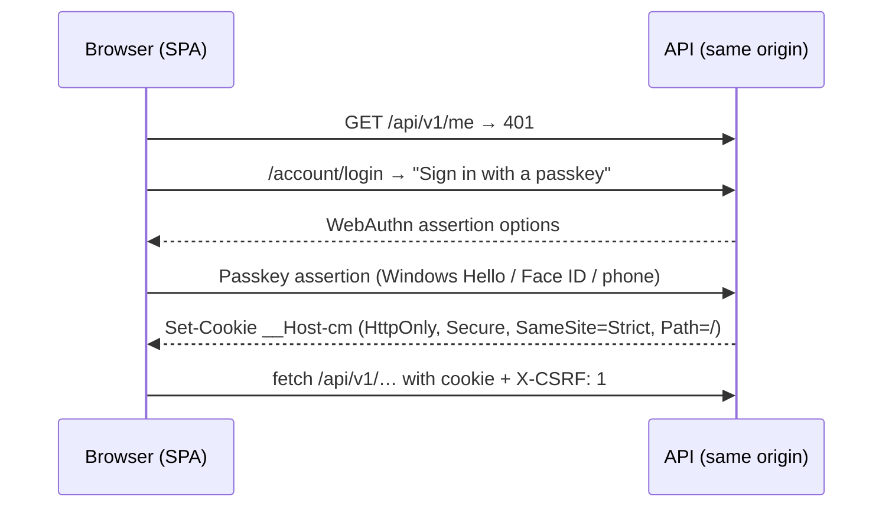
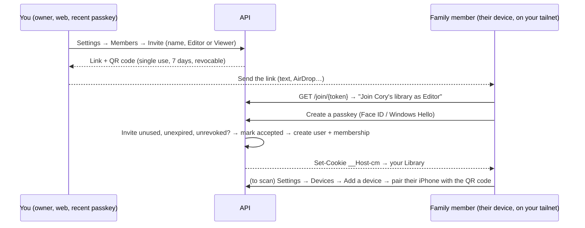

# 07 — Authentication and authorization

## Summary

| | Decision |
|---|---|
| Who issues tokens | **Our API**, using **OpenIddict 7** (a mature, widely used open-source OIDC server library for ASP.NET Core) on top of **ASP.NET Core Identity** |
| First-time setup | A **one-time setup code** printed by the server on first start. You open the web app, enter it, and create the owner account with a passkey. |
| Web | **Passkeys** (WebAuthn) on your Tailscale HTTPS name; a same-origin HttpOnly session cookie (BFF style); CSRF header on mutations |
| iPhone app | **Paired, not signed in:** scan a QR code from the web app's *Add a device* screen. You get a device-bound, rotating refresh token in the Keychain, plus an optional **Face ID app lock**. |
| Network | Reachable **only over your Tailscale network**: a second wall in front of the app's own sign-in |
| API authorization | **Deny by default**; scope check + **resource-based library roles**; platform `admin` role for ops |
| Proof | An **authorization-matrix test** runs every endpoint × every role on every PR |

**Why no Sign in with Apple:** the paid Apple Developer Program now allows it (ADR-024), but pairing already covers it. Passkeys inside the iPhone app would need associated domains, and Apple's CDN fetches the association file from the public internet, which can't reach a tailnet-only server (see [10](10-hosting-and-devops.md#getting-the-app-on-your-iphone)). Pairing is also a better fit for a self-hosted app: it's how Plex-style and Immich-style home servers onboard phones. There are no third-party identity providers at all.

## Why passwordless

Without passwords there's no credential stuffing, no reset flow to secure, no hashing to get right, and no breached-password checks. On the web you sign in with a passkey (Windows Hello on this PC, Face ID on an iPhone's Safari, or a phone). On the iPhone app you never sign in at all: the device is paired once and then trusted until you revoke it.

## Flows

### First run: create the owner

```mermaid
sequenceDiagram
  participant PC as Server (first start)
  participant B as Browser on the PC
  PC->>PC: No owner yet → generate a setup code (single use, 24 h)<br/>print it in the logs + write secrets/setup-code.txt
  B->>PC: Open https://pc.tailnet.ts.net → "Set up CollectionMaxxing"
  B->>PC: Enter the setup code + your display name
  PC-->>B: WebAuthn registration options
  B->>PC: Create a passkey (Windows Hello)
  PC->>PC: Create owner + personal library; delete the setup code; setup endpoints are disabled for good
  PC-->>B: Set-Cookie __Host-cm → Library
```

- The setup endpoints exist only while there is no owner. After that they return 404.
- **Recovery** (lost every passkey): run `docker compose exec api cm-admin recovery-code` on the PC. That prints a one-time code that lets you register a new passkey. Physical access to your PC is the recovery factor.

### Web: passkeys + same-origin cookie



- Uses the **passkey support built into ASP.NET Core Identity in .NET 10**. The relying-party ID is your Tailscale HTTPS name, which is exactly what WebAuthn needs (a secure, stable hostname).
- The cookie uses the `__Host-` prefix: it's bound to the exact host, has no `Domain` attribute, and is Secure-only.
- **CSRF:** `SameSite=Strict`, **and** every non-GET request must carry `X-CSRF: 1`. We allow **no** CORS origins (the BFF pattern).
- 8-hour sliding session, 30-day absolute. Re-authentication (a fresh passkey assertion) is required for adding devices, adding passkeys and deleting things in bulk.
- Add more passkeys (another browser, a phone) from Settings while signed in. Removing the last one is blocked.

### iPhone: pair once with a QR code

```mermaid
sequenceDiagram
  participant B as Web app (signed in, recent passkey)
  participant API as API
  participant App as iPhone app (first launch)
  B->>API: Settings → Devices → Add a device
  API-->>B: QR code { server URL, pairing token } + 6-digit fallback code<br/>(single use, expires in 2 minutes)
  App->>App: "Pair with your server" → scan the QR code (Apple Vision)
  App->>API: POST /connect/token grant_type=urn:cm:device_pairing, pairing_token, device_name
  API->>API: Token valid, unused and unexpired? → mark it used → create a device authorization
  API-->>App: access_token (10 min) + refresh_token (rotating, 90 days sliding)
  App->>App: refresh_token → Keychain (this device only); access_token → memory
```

- **Device-bound:** every phone has its own authorization, and Settings → Devices lists them by name with their last-seen time. **Revoke** kills its tokens immediately, and its access token expires within 10 minutes.
- **Refresh rotation:** OpenIddict rotates refresh tokens. Replaying a used one **revokes that device's whole chain**, so a stolen refresh token dies the moment either copy is used.
- **Face ID app lock** (optional, on by default): the app asks for Face ID when it opens or comes back after 5 minutes. It uses Apple's LocalAuthentication, which needs no paid capability.

### Family members: invite → passkey → pair



- **Nobody joins without an invite.** The link also only works from your tailnet, so the person must be added to Tailscale first. That's two independent gates.
- Each member has **their own passkeys and their own paired devices**. Nothing is shared between accounts.
- **Removing a member** deletes their membership and revokes all their devices and sessions immediately. Their account is deactivated, since it has no library left. The items they added stay and still show who added them.
- **The owner can't be removed.** Transferring ownership is a separate action that needs a fresh passkey.

### Sign out, devices and deletion

- **Unpair (iPhone):** revoke the refresh token (`/connect/revoke`), clear the Keychain, and return to the pairing screen.
- **Signed-in devices and browsers:** listed in Settings, and each can be revoked.
- **Web sessions:** sign-out, "sign out everywhere", member removal and account deletion revoke the server-side `web_sessions` rows, so a copied cookie stops working.
- **Delete account:** needs a fresh passkey assertion. It revokes all devices and sessions. The user is soft-deleted immediately (can't sign in) and their data is purged within 30 days. Audit entries are anonymised.

## Authorization model

### Layers

```
Request (only possible from a device on your tailnet)
  │
  ├─ 1. Authentication     cookie (web) or bearer (iPhone) → ClaimsPrincipal; otherwise 401
  ├─ 2. Fallback policy    every endpoint requires an authenticated user unless explicitly [AllowAnonymous]
  ├─ 3. Scope              bearer tokens must carry `api`
  ├─ 4. Route-group policy /api/admin/* requires platform role `admin` (the owner)
  ├─ 5. Resource policy    library membership + minimum role for the endpoint (Viewer | Editor | Owner)
  │                         → not a member: 404 (don't reveal existence); member without the role: 403
  └─ 6. Data filter        EF Core global query filter on library_id (defence in depth)
```

### Library roles

| Action | Viewer | Editor | Owner |
|---|:-:|:-:|:-:|
| Browse items, search, stats, scan to check ownership | ✓ | ✓ | ✓ |
| Add / edit / delete items, commit scans | | ✓ | ✓ |
| Manage locations and tags | | ✓ | ✓ |
| Rename library, export | | | ✓ |
| Invite / remove members, change roles | | | ✓ |
| Add / revoke devices for themselves | ✓ | ✓ | ✓ |
| Transfer ownership / delete library | | | ✓ (re-auth) |

In v1 there's one library, yours. Family members join it by invite as Editor or Viewer. The authorization-matrix test covers every role from the very first endpoint.

### Implementation

```csharp
// Program.cs (sketch)
builder.Services.AddAuthorizationBuilder()
    .SetFallbackPolicy(new AuthorizationPolicyBuilder().RequireAuthenticatedUser().Build())
    .AddPolicy(Policies.Admin, p => p.RequireRole(Roles.Admin));

var lib = app.MapGroup("/api/v1/libraries/{libraryId:guid}")
             .AddEndpointFilter<LibraryMembershipFilter>();   // loads membership once, 404 if none

lib.MapGet("/items", ListItems.Handle).RequireLibraryRole(LibraryRole.Viewer);
lib.MapPost("/items", AddItem.Handle).RequireLibraryRole(LibraryRole.Editor);
```

- `RequireLibraryRole` adds endpoint metadata. `LibraryMembershipFilter` enforces it with an `IAuthorizationService` resource-based check.
- For endpoints not under a library route (`/scan-sessions/{id}`, `/items/{id}` lookups), the handler resolves the owning library first and then runs the same check, via `ILibraryAccess.RequireAsync(libraryId, role)`.
- **Never trust IDs from the body for authorization.** The library comes from the route or from the stored resource.

### Proving it: tests

1. **Every-endpoint-has-a-policy test.** It reflects over `EndpointDataSource` and fails if any endpoint lacks `RequireLibraryRole`, `RequireAuthorization` or `AllowAnonymous`. Anonymous endpoints must be on an explicit allow-list (`/health/*`, `/setup` while no owner exists, `/account/login`, `/join/{token}` with a valid invite, the token endpoint, static files).
2. **Authorization matrix.** One table-driven test lists every endpoint with its expected status for `anonymous`, `other-user`, `viewer`, `editor`, `owner` and `admin`. It runs against the real pipeline (WebApplicationFactory + Testcontainers Postgres) on every PR.
3. **IDOR tests:** user B requests user A's item, session, photo, cover and export by ID, and expects 404 every time.
4. **Setup and pairing tests:**
   - the setup endpoints 404 once an owner exists;
   - a setup code works once;
   - a pairing token is single-use, expires after 2 minutes, and can only be created with a recent passkey assertion;
   - 6-digit codes are rate-limited per client address (5 wrong guesses lock that address for a minute, not the pairing; X-Forwarded-For is believed only from configured trusted proxies);
   - a revoked device's refresh token fails;
   - a replayed refresh token revokes that device's chain.
5. **Token tests:** expired, wrong-audience and missing-scope tokens are rejected.
6. **Invite tests:**
   - an invite works once; expired or revoked invites fail;
   - the member gets exactly the invited role;
   - only the owner can invite, and only with a recent passkey;
   - removing a member makes their refresh tokens and cookie fail at once;
   - the owner can't be removed.

## Keys and secrets

| Secret | Where | Rotation |
|---|---|---|
| OpenIddict **signing** and **encryption** certificates | PFX files in the PC's secrets folder (`C:\CollectionMaxxing\secrets`, readable only by your account and the container), mounted as Docker secrets | Yearly, with overlap: publish the new key, then switch to signing with it, then retire the old one |
| One-time setup / recovery codes | Generated on demand, written to the secrets folder, deleted after use or expiry | Single use |
| ASP.NET Data Protection key ring | The `files` volume, encrypted at rest by BitLocker | Automatic, 90 days |
| Provider API keys (Google Books, TMDB, IGDB) | `.env` in the secrets folder | Yearly or on compromise |

Development uses `dotnet user-secrets` and development certificates. Nothing secret is ever committed (enforced by GitHub secret scanning + push protection).
