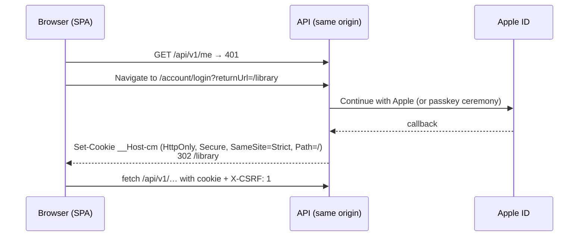

# 07 — Authentication and authorization

## Summary

| | Decision |
|---|---|
| Who issues tokens | **Our API**, using **OpenIddict 7** (a mature, widely used open-source OIDC server library for ASP.NET Core) on top of **ASP.NET Core Identity** |
| How users prove who they are | **Passwordless only:** Sign in with Apple (v1), passkeys / WebAuthn (v1, web; also usable on iOS), Google (v1.1) |
| iOS app | OAuth 2.0 **Authorization Code + PKCE** (public client) → short-lived access token + rotating refresh token in the Keychain |
| Web app | **Same-origin HttpOnly session cookie** (BFF style). No tokens in JavaScript; CSRF header on mutations. |
| API authorization | **Deny by default**; scope check + **resource-based library roles**; platform `admin` role for ops |
| Proof | An **authorization-matrix test** runs every endpoint × every role on every PR |

**Decision needed (D2):** the managed alternative is **Microsoft Entra External ID**. It supports Apple and Google sign-in, is free at our scale, and Microsoft runs it. The API side barely changes: it would validate Entra-issued JWTs instead of its own. We'd lose control of the login UI and get a more web-view-like iOS experience. I recommend OpenIddict because it gives the best iOS UX, has no third-party dependency, and stays entirely in .NET. Switching later is cheap because the API is a standard resource server either way.

## Why passwordless

Without passwords there's no credential stuffing, no reset flow to secure, no hashing to get right, and no breached-password checks. Sign in with Apple is also effectively mandatory: App Store guideline 4.8 requires an equivalent privacy-focused option whenever third-party login is offered, and it's the best UX on iPhone anyway.

## Flows

### iOS: Authorization Code + PKCE

```mermaid
sequenceDiagram
  participant App as iOS app
  participant Sheet as System auth sheet<br/>(ASWebAuthenticationSession)
  participant Auth as API: /connect/* and /account/*
  participant Apple as Apple ID
  App->>App: Create code_verifier, code_challenge (S256), state, nonce
  App->>Sheet: Open /connect/authorize?client_id=cm-ios&scope=openid offline_access api
  Sheet->>Auth: GET /connect/authorize
  Auth-->>Sheet: 302 /account/login (not signed in)
  Sheet->>Apple: Continue with Apple (native Face ID sheet)
  Apple-->>Auth: Authorization code + id_token (form_post)
  Auth->>Auth: Validate id_token (iss, aud, exp, nonce, signature via Apple JWKS)
  Auth->>Auth: Find user by (apple, sub) or create user + personal library
  Auth-->>Sheet: 302 collectionmaxxing://auth/callback?code=…&state=…
  Sheet-->>App: code
  App->>Auth: POST /connect/token (code + code_verifier)
  Auth-->>App: access_token (10 min) + refresh_token (rotating) + id_token
  App->>App: refresh_token → Keychain; access_token → memory
```

- **Redirect URI:** a custom scheme for v1. It moves to a **universal link** (`https://[YOUR-DOMAIN]/auth/callback`, verified through `apple-app-site-association`) before launch, so no other app can claim the callback.
- **Refresh:** `POST /connect/token grant_type=refresh_token`. OpenIddict **rotates** refresh tokens. Replaying an already-used refresh token (after a short leeway) **revokes the whole token chain**, so a stolen refresh token dies the moment either party uses it.
- **Lifetimes:** access token 10 min; refresh token 14 days sliding, 90 days absolute. Change these in config.
- **v1.1 native button:** `expo-apple-authentication` shows Apple's native sheet directly in the app. The resulting Apple `identityToken` is exchanged at `/connect/token` through an OAuth **token-exchange** grant (RFC 8693 shape, implemented as an OpenIddict custom grant handler). The server validates the Apple token exactly as above. One tap, no browser sheet.

### Web: same-origin cookie session



- The cookie name uses the `__Host-` prefix: it's bound to the exact host, has no `Domain` attribute, and is Secure-only.
- **CSRF:** `SameSite=Strict`, **and** every non-GET request must carry `X-CSRF: 1`. A cross-origin page can't set a custom header without a CORS preflight, and we allow **no** CORS origins. This is the BFF pattern that Duende and Microsoft recommend for SPAs.
- 8-hour sliding session, 30-day absolute; re-authentication is required for account deletion and passkey management.

### Passkeys

- Uses the passkey support built into ASP.NET Core Identity in .NET 10: registration and assertion ceremonies on `/account/passkey/*`.
- A user can add a passkey after signing in with Apple, and passkey-first sign-up works on the web.
- Associated domains (`webcredentials:[YOUR-DOMAIN]`) let iCloud Keychain passkeys work in the iOS auth sheet too.

### Account linking rules (security-critical)

- Accounts are keyed by the **(provider, subject)** pair, **never** by email. Apple often gives a private-relay email, and auto-linking by email is a classic account-takeover hole.
- To link Google to an existing account, you must be **signed in already** and then add it from Settings.
- Removing the last remaining sign-in method is blocked.

### Sign out, devices and deletion

- **Sign out (iOS):** revoke the refresh token (`/connect/revoke`), clear the Keychain.
- **Signed-in devices:** lists OpenIddict authorizations. Revoking one kills its tokens immediately; the access token is gone within ≤ 10 min.
- **Delete account:** requires re-authentication within 10 minutes. It revokes all tokens and calls **Apple's token-revocation endpoint** (Apple requires this when the account used Sign in with Apple). The user is soft-deleted immediately (can't sign in) and their data is purged within 30 days. Audit entries are anonymised.

## Authorization model

### Layers

```
Request
  │
  ├─ 1. Authentication     cookie (web) or bearer (iOS) → ClaimsPrincipal; otherwise 401
  ├─ 2. Fallback policy    every endpoint requires an authenticated user unless explicitly [AllowAnonymous]
  ├─ 3. Scope              bearer tokens must carry `api`
  ├─ 4. Route-group policy /api/admin/* requires platform role `admin`
  ├─ 5. Resource policy    library membership + minimum role for the endpoint (Viewer | Editor | Owner)
  │                         → not a member: 404 (don't reveal existence); member without the role: 403
  └─ 6. Data filter        EF Core global query filter on library_id (defence in depth)
```

### Library roles

| Action | Viewer | Editor | Owner |
|---|:-:|:-:|:-:|
| Browse items, search, stats, scan to check ownership | ✓ | ✓ | ✓ |
| Add / edit / delete items, commit scans | | ✓ | ✓ |
| Manage locations and tags | | ✓ | ✓ |
| Rename library, export | | | ✓ |
| Invite / remove members, change roles (v1.1) | | | ✓ |
| Transfer ownership / delete library | | | ✓ (re-auth) |

In v1 every user is the Owner of exactly one library. Roles still exist and are tested from the start, so household sharing in v1.1 needs no security redesign.

### Implementation

```csharp
// Program.cs (sketch)
builder.Services.AddAuthorizationBuilder()
    .SetFallbackPolicy(new AuthorizationPolicyBuilder().RequireAuthenticatedUser().Build())
    .AddPolicy(Policies.Admin, p => p.RequireRole(Roles.Admin));

var lib = app.MapGroup("/api/v1/libraries/{libraryId:guid}")
             .AddEndpointFilter<LibraryMembershipFilter>();   // loads membership once, 404 if none

lib.MapGet("/items", ListItems.Handle).RequireLibraryRole(LibraryRole.Viewer);
lib.MapPost("/items", AddItem.Handle).RequireLibraryRole(LibraryRole.Editor);
```

- `RequireLibraryRole` adds endpoint metadata. `LibraryMembershipFilter` reads it and enforces it with an `IAuthorizationService` resource-based check.
- For endpoints not under a library route (`/scan-sessions/{id}`, `/items/{id}` lookups), the handler resolves the owning library first and then runs the same check. Shared helper: `ILibraryAccess.RequireAsync(libraryId, role)`.
- **Never trust IDs from the body for authorization.** The library comes from the route or from the stored resource.

### Proving it: tests

1. **Every-endpoint-has-a-policy test.** It reflects over `EndpointDataSource` and fails if any endpoint lacks `RequireLibraryRole`, `RequireAuthorization` or `AllowAnonymous`. Anonymous endpoints must be on an explicit allow-list (`/health/*`, `/account/login`, the OIDC endpoints, static files).
2. **Authorization matrix.** One table-driven test lists every endpoint with its expected status for `anonymous`, `other-user`, `viewer`, `editor`, `owner` and `admin`. It runs against the real pipeline (WebApplicationFactory + Testcontainers Postgres) on every PR.
3. **IDOR tests:** user B requests user A's item, session, photo, cover and export by ID, and expects 404 every time.
4. **Token tests:** expired, wrong-audience, missing-scope and replayed-refresh tokens are all rejected; a revoked device stops working.

## Keys and secrets

| Secret | Where | Rotation |
|---|---|---|
| OpenIddict **signing** and **encryption** certificates | Key Vault (certificate objects), loaded at start-up via managed identity | Yearly, with overlap: publish the new key, then switch to signing with it, then retire the old one |
| Apple Sign-in private key (.p8) + key ID + team ID | Key Vault | When Apple requires it / on compromise |
| Google OAuth client secret | Key Vault | Yearly |
| ASP.NET Data Protection key ring | Blob Storage, protected by a Key Vault key | Automatic, 90 days |

Development uses `dotnet user-secrets` and development certificates. Nothing secret is ever committed (enforced by GitHub secret scanning + push protection).
