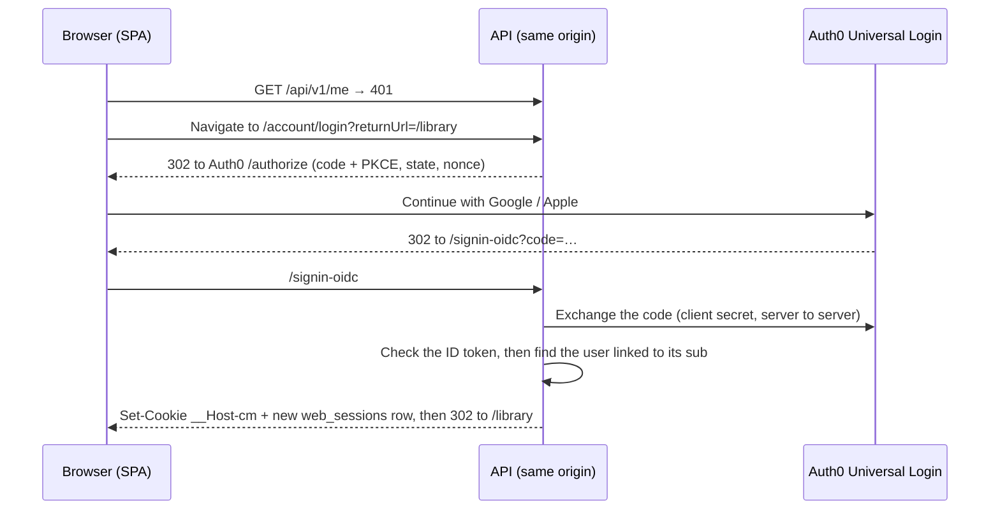
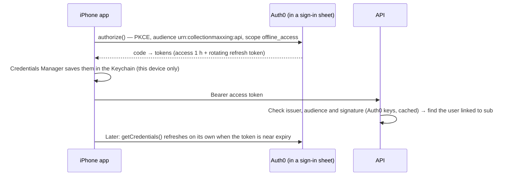
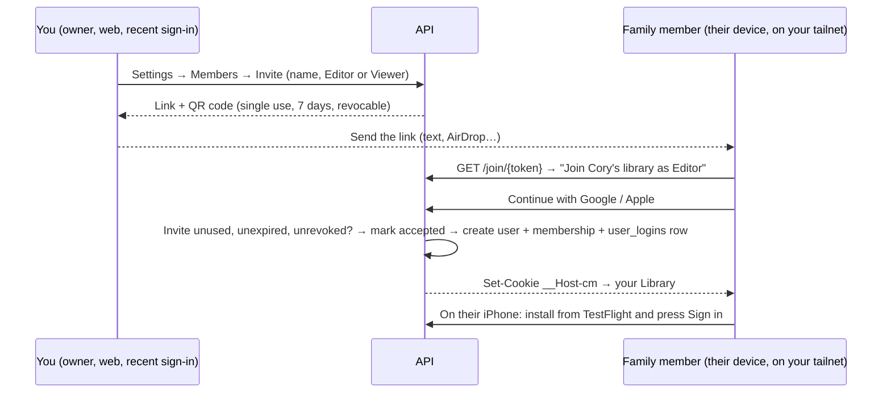

# 07 — Authentication and authorization

## Summary

| | Decision |
|---|---|
| Who signs people in | **Auth0** (Free plan), through Universal Login, with **Google** and **Sign in with Apple**. No passwords. ([ADR-025](12-decision-log.md#adr-025-auth0-for-sign-in-our-api-keeps-authorization)) |
| Who decides what you can do | **Our API.** Auth0 proves *who* someone is. An Auth0 identity gets in only if it is linked to one of our users (`user_logins`). |
| Web | The API runs the OIDC code flow itself (Microsoft's `AddOpenIdConnect`). The result is the same-origin `__Host-cm` cookie: **30 days idle, 1 year at most**. The browser never holds a token. |
| iPhone app | **Authorization Code + PKCE** with `react-native-auth0`. A rotating refresh token lives in the Keychain, plus an optional **Face ID app lock**. The API checks the access token with `AddJwtBearer`. |
| First-time setup | A **one-time setup code** printed by the server on first start. You sign in with Google or Apple, enter the code, and become the owner of a new library. |
| Network | Reachable **only over your Tailscale network**: a second wall in front of the app's own sign-in |
| API authorization | **Deny by default**; **resource-based library roles**; platform `admin` role for ops |
| Proof | An **authorization-matrix test** runs every endpoint × every role on every PR |

The plan and the reasons are in [14](14-auth0-migration.md). This page describes how it works now.

## Flows

### Linking: who gets in

`user_logins` holds `user_id`, `provider` (`auth0`), `subject` (Auth0's `sub`, such as `google-oauth2|…` or `apple|…`) and `created_at`. `subject` is unique, so an identity belongs to at most one user.

- The API **never matches people by email**. An address from a provider isn't proof of who someone is. Email is stored for display only.
- An identity that isn't linked gets **403 `account.not_linked`** ("This account isn't part of a library. Ask the owner for an invite"). Nothing is created for it. The web shows a page for it (`/account/not-linked`).
- There are four ways to link an identity, and no others:

| Path | When | What happens after the Auth0 sign-in |
|---|---|---|
| **Setup** | No owner exists (a fresh install) | You enter the setup code. The identity becomes the owner of a new library. |
| **Invite** | `/join/{token}` | The invite token travels in a sealed, short-lived cookie during the Auth0 round trip. Then the user and membership are created. |
| **Add a sign-in method** | Signed in, with a recent sign-in | The new identity is linked to you, so one person can use both Google and Apple. Removing the last one is blocked (409). |
| **Recovery** | You've lost every linked identity | `cm-admin recovery-code` on the PC prints a one-time code. You sign in with the new identity and enter the code, and it is linked to the owner. |

### First run: create the owner

```mermaid
sequenceDiagram
  participant PC as Server (first start)
  participant B as Browser on the PC
  participant A as Auth0
  PC->>PC: No owner yet → generate a setup code (single use, 24 h)<br/>print it in the logs + write secrets/setup-code.txt
  B->>PC: Open https://pc.tailnet.ts.net → "Set up CollectionMaxxing"
  B->>PC: POST /setup (the setup code + your display name) → code checked first
  B->>A: GET /account/login?intent=setup → Continue with Google / Apple
  A-->>B: Back to /signin-oidc
  PC->>PC: Create owner + personal library + user_logins row; delete the code
  PC-->>B: Set-Cookie __Host-cm → Library
```

- The setup endpoints exist only while there is no owner. After that they return 404.
- **Recovery** (lost every linked identity): `docker compose exec api cm-admin recovery-code` on the PC. Physical access to your PC is the recovery factor.

### Web: Auth0 signs you in, our cookie keeps you in



- **No tokens in the browser:** the ID token is checked and thrown away (`SaveTokens = false`). After that it's the cookie and a `web_sessions` row, which Settings lists and can revoke.
- **Cookie:** `__Host-` prefix (bound to the exact host, no `Domain`, Secure-only), `HttpOnly`, `SameSite=Strict`. **30 days since you last used it, 1 year at most.** A cookie whose `web_sessions` row is revoked stops working at once.
- **CSRF:** `SameSite=Strict`, **and** every non-GET request must carry `X-CSRF: 1`. We allow **no** CORS origins.
- **Public origin:** the `redirect_uri` and the sign-out return address come from `Auth:PublicOrigin`, never from the request's Host header.
- **Sign out:** revokes the `web_sessions` row, clears the cookie and returns Auth0's `/v2/logout` address, which the app navigates to, so the next sign-in shows the account picker.
- **`RequireRecentSignIn`:** actions that need a fresh sign-in (inviting, removing a sign-in method, deleting the account) pass only if the cookie's `auth_time` (from the Auth0 ID token) is under 5 minutes old. Otherwise the API answers 401 `reauth_required` with `reauth: true`, and the app sends you through `/account/login?reauth=1`, which asks Auth0 for `max_age=0`. A bearer token never counts as recent.

### iPhone: Auth0's SDK and the Keychain



- **Sign-in:** one button. It opens iOS's sign-in sheet (`ASWebAuthenticationSession`), where you pick Google or Apple.
- **JWT bearer** is the only bearer scheme. `AddJwtBearer` checks the issuer (your Auth0 tenant), the audience (`urn:collectionmaxxing:api`) and the signature. The `sub` is then looked up in `user_logins`, the same as on the web.
- **Refresh token:** rotating, 90 days idle, 1 year at most. The Credentials Manager handles storage and refresh.
- **Finding the server:** the address is built into the TestFlight build (a secret in the `testflight` environment).
- **Face ID app lock** (optional, on by default): the app asks for Face ID when it opens or comes back after 5 minutes. It uses Apple's LocalAuthentication, which needs no paid capability.

### Family members: invite → sign in



- **Nobody joins without an invite.** The link also only works from your tailnet, so the person must be added to Tailscale first. That's two independent gates.
- Each member has **their own sign-in methods and their own devices**. Nothing is shared between accounts.
- **Removing a member** deletes their membership and deactivates their account. The deactivation check refuses them on their next call, whatever token they hold, and their web sessions and refresh tokens are revoked. The items they added stay and still show who added them.
- **The owner can't be removed.**

### App sign-ins, revocation and deletion

- **Browsers:** Settings lists `web_sessions` (label, created, last seen). Each can be revoked, or all of them.
- **iPhones:** after sign-in the app registers itself (`POST /api/v1/me/app-sign-ins`, with a device name and an install id), so Settings → Devices lists it with its last-seen time. Signing in again on the same install updates its row.
- **Sign out all iPhones** (`DELETE /api/v1/me/app-sign-ins`) does two things:
  1. sets `users.tokens_not_before = now`, so any access token issued before then is refused at once (access tokens live up to an hour);
  2. asks Auth0 to end the person's refresh tokens, by deleting their **grants** (`DELETE /api/v2/grants?user_id=…`).
  If Auth0 can't be reached, the cutoff already locks the phones out and a background job finishes the revoke later.
- **Why grants:** the Free plan doesn't allow Auth0's refresh-token endpoints, so we can't revoke one phone's token. Deleting the grants signs out **all of that person's phones** together. The Management app has only the scopes `delete:grants` and `delete:users`.
- **Delete account:** needs a recent sign-in. The user is soft-deleted at once (can't sign in), sessions are revoked, the **Auth0 user is deleted** so nothing is left there, and their data is purged within 30 days. Audit entries are anonymised.

## Authorization model (unchanged)

### Layers

```
Request (only possible from a device on your tailnet)
  │
  ├─ 1. Authentication     cookie (web) or JWT bearer (iPhone) → ClaimsPrincipal; otherwise 401
  ├─ 2. Linked user        the token's sub must be in user_logins, else 403 account.not_linked;
  │                        a deactivated user, or a token issued before tokens_not_before, is refused
  ├─ 3. Fallback policy    every endpoint requires an authenticated user unless explicitly [AllowAnonymous]
  ├─ 4. Route-group policy /api/admin/* requires platform role `admin` (the owner)
  ├─ 5. Resource policy    library membership + minimum role for the endpoint (Viewer | Editor | Owner)
  │                         → not a member: 404 (don't reveal existence); member without the role: 403
  └─ 6. Data filter        EF Core global query filter on library_id (defence in depth)
```

### Library roles

| Action | Viewer | Editor | Owner |
|---|:-:|:-:|:-:|
| Browse items, search, stats, scan to check ownership | ✓ | ✓ | ✓ |
| Add / edit / delete items, commit scans | | ✓ | ✓ |
| Manage locations and tags | | ✓ | ✓ |
| Rename library, export | | | ✓ |
| Invite / remove members, change roles | | | ✓ (recent sign-in to invite) |
| See and sign out their own browsers and iPhones | ✓ | ✓ | ✓ |
| Delete own account | ✓ | ✓ | ✓ (recent sign-in) |

In v1 there's one library, yours. Family members join it by invite as Editor or Viewer. The authorization-matrix test covers every role from the very first endpoint.

### Implementation

```csharp
// Program.cs (sketch)
builder.Services.AddAuthorizationBuilder()
    .SetFallbackPolicy(new AuthorizationPolicyBuilder().RequireAuthenticatedUser().Build())
    .AddPolicy(Policies.Admin, p => p.RequireRole(Roles.Admin));

var lib = app.MapGroup("/api/v1/libraries/{libraryId:guid}")
             .AddEndpointFilter<LibraryMembershipFilter>();   // loads membership once, 404 if none

lib.MapGet("/items", ListItems.Handle).RequireLibraryRole(LibraryRole.Viewer);
lib.MapPost("/items", AddItem.Handle).RequireLibraryRole(LibraryRole.Editor);
```

- `RequireLibraryRole` adds endpoint metadata. `LibraryMembershipFilter` enforces it with an `IAuthorizationService` resource-based check.
- For endpoints not under a library route (`/scan-sessions/{id}`, `/items/{id}` lookups), the handler resolves the owning library first and then runs the same check, via `ILibraryAccess.RequireAsync(libraryId, role)`.
- **Never trust IDs from the body for authorization.** The library comes from the route or from the stored resource.

### Proving it: tests

Tests sign in with a **fake Auth0**: WireMock serves discovery, the signing keys and the token endpoint, and the JWTs are signed with a test key. Everything else uses `TestAuthHandler` and the `X-Test-User` header.

1. **Every-endpoint-has-a-policy test.** It reflects over `EndpointDataSource` and fails if any endpoint lacks `RequireLibraryRole`, `RequireAuthorization` or `AllowAnonymous`. Anonymous endpoints must be on an explicit allow-list (`/health/*`, `/setup` while no owner exists, `/account/login`, `/signin-oidc`, `/account/not-linked`, `/join/{token}`, `/api/v1/invites/{token}` with a valid invite, `/account/recover`, static files).
2. **Authorization matrix.** One table-driven test lists every endpoint with its expected status for `anonymous`, `other-user`, `viewer`, `editor`, `owner` and `admin`. It runs against the real pipeline (WebApplicationFactory + Testcontainers Postgres) on every PR.
3. **IDOR tests:** user B requests user A's item, session, photo, cover and export by ID, and expects 404 every time.
4. **Sign-in tests:**
   - a valid token for an unlinked identity gets `account.not_linked` and creates nothing;
   - the setup endpoints 404 once an owner exists, and a setup code works once;
   - each link path works once, and a second identity can't take over a linked `subject`;
   - `RequireRecentSignIn` refuses a cookie older than 5 minutes and any bearer token;
   - a token issued before `tokens_not_before` is refused, and one issued after it works;
   - expired, wrong-issuer and wrong-audience tokens are rejected;
   - code endpoints are rate-limited per client address (X-Forwarded-For is believed only from configured trusted proxies).
5. **Invite tests:**
   - an invite works once; expired or revoked invites fail;
   - the member gets exactly the invited role;
   - only the owner can invite, and only with a recent sign-in;
   - removing a member makes their cookie and tokens fail at once;
   - the owner can't be removed.

## Keys and secrets

| Secret | Where | Rotation |
|---|---|---|
| Auth0 signing keys | Auth0 | Auth0 rotates them. Nothing for us to do. |
| Web app client secret; Management (M2M) client id and secret | `.env` on the PC (values from `<secrets>\auth0\api.env`). All six `CM_AUTH0_*` and `CM_PUBLIC_ORIGIN` values are required: the stack won't start without them. | Rotate in the Auth0 dashboard, then re-run `deploy/auth0/Apply-Auth0.ps1` ([runbook](../deploy/runbooks/rotate-signing-keys.md)) |
| Google OAuth client secret, Apple `.p8` key | In Auth0, with copies in `secrets\auth0\` so the script can rebuild the tenant | Don't expire |
| Provisioner M2M credentials | `secrets\auth0\provisioner.env` | On compromise |
| One-time setup / recovery codes | Generated on demand, written to the secrets folder, deleted after use or expiry | Single use |
| ASP.NET Data Protection key ring | The `files` volume, encrypted at rest by BitLocker. Seals the cookie, the sign-in intent cookie and the OIDC state. | Automatic, 90 days |
| Provider API keys (Google Books, TMDB, IGDB) | `.env` in the secrets folder | Yearly or on compromise |

Development uses `dotnet user-secrets`. Nothing secret is ever committed (enforced by GitHub secret scanning + push protection).
