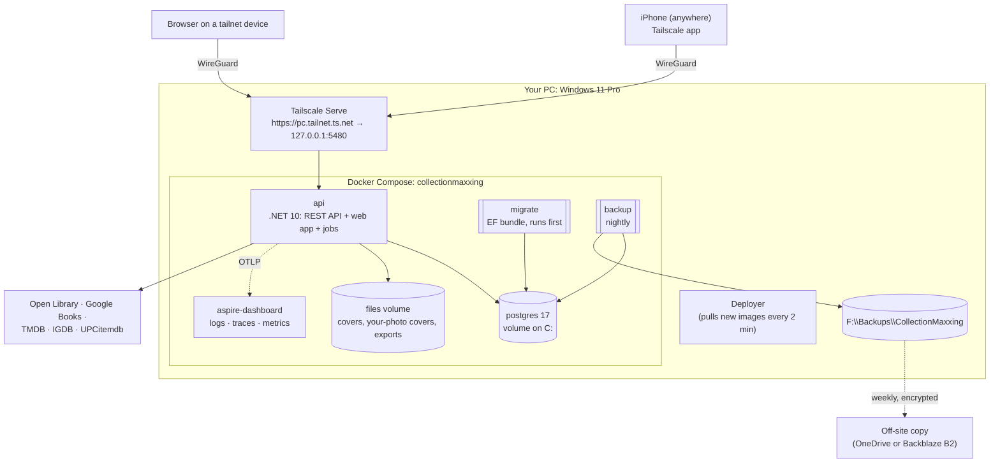

# 10 — Hosting and DevOps (self-hosted)

**Decision (2026-10-12):** CollectionMaxxing is **self-hosted on your gaming PC**. There's no cloud hosting bill, and your data stays at home.

**The machine:**

- Windows 11 Pro
- Intel i9-13900KF (24 cores) and 32 GB RAM
- NVIDIA RTX 4070 Ti (12 GB)
- C: 1.8 TB SSD (326 GB free), F: 1.8 TB (415 GB free), plus D: and E:
- Docker 24.0.7 and Tailscale already installed

The app needs a tiny fraction of that: well under 1 CPU core and ~1 GB RAM at idle. You won't notice it while gaming.

## How your iPhone reaches it: Tailscale

You already have **Tailscale** installed. It puts your PC and your iPhone on a private, encrypted network (WireGuard) that works from anywhere: home Wi-Fi, a thrift store, cellular.

- **Nothing is exposed to the internet.** No port forwarding, no public IP, no router changes.
- **HTTPS for free.** `tailscale serve` gives the PC a real certificate for `https://<pc-name>.<your-tailnet>.ts.net` and forwards it to the API on `localhost`. That one URL serves the API and the web app.
- **Who can reach it:** only devices signed in to your tailnet. Tailscale's free Personal plan allows **6 users with unlimited devices**: you plus 5 family members. The app's own sign-in still applies on top.
- **On the iPhone:** install the Tailscale app and turn on *VPN On Demand*, so it connects automatically when the CollectionMaxxing app needs it.

*Later, if you ever want public share links or family without Tailscale:* a Cloudflare Tunnel can publish just the web app on a domain, with no open ports either. Not needed for v1.

## What runs on the PC



| Service | Image / tool | Notes |
|---|---|---|
| `api` | our .NET 10 image (chiseled, non-root), published to GitHub Container Registry (public, with build attestations) | Listens on `127.0.0.1:5480` only (SABnzbd already holds 8080; the port is set in `.env`); Tailscale Serve is the only way in. Serves the web app from `wwwroot` at the site root (`/`), so the tailnet URL opens the library. Background jobs (UPC pending queue, exports) run in-process. |
| `migrate` | EF Core migration bundle | A one-shot container; `api` starts only after it succeeds |
| `postgres` | `postgres:17` | Not published to the host at all; only `api`, `migrate` and `backup` can reach it on the compose network. `pg_trgm` is enabled by a migration. |
| `files` | Docker volume | Replaces cloud blob storage (`IBlobStore` → file-system implementation) |
| `aspire-dashboard` | Microsoft's standalone Aspire Dashboard | OpenTelemetry logs, traces and metrics in a browser, on `127.0.0.1` only |
| `backup` | `postgres:17` + rclone, on a schedule | See Backups below |

**Sign-in settings (`.env`):** the API needs `CM_PUBLIC_ORIGIN` (the address people browse to), `CM_AUTH0_DOMAIN`, `CM_AUTH0_WEB_CLIENT_ID`, `CM_AUTH0_WEB_CLIENT_SECRET`, `CM_AUTH0_MANAGEMENT_CLIENT_ID` and `CM_AUTH0_MANAGEMENT_CLIENT_SECRET`. All six are required, and the stack won't start without them. Without the Management credentials, "Sign out all iPhones" would do nothing at Auth0. `deploy/auth0/Apply-Auth0.ps1` writes the values to `<secrets>uth0pi.env`; copy them into `.env`. There are no signing certificates to make or rotate: Auth0 holds the token keys ([07](07-authentication-and-authorization.md#keys-and-secrets)). There is no setup code and no sign-in file in the secrets folder. Signing in needs the internet and Auth0; a browser that is already signed in doesn't, because the cookie is ours.

**Docker:** keep Docker Desktop (WSL2 backend), but **update it**. 24.0.7 is from 2023. Set it to start when you sign in, and turn on Windows' "Use my sign-in info to automatically finish setting up after an update", so the stack comes back after Windows Update reboots.

**The GPU** isn't used: recognition runs on the iPhone with Apple's frameworks (ADR-017). It's there as a free upgrade path if the M3 evals ever show real misses, but that would mean going beyond Apple-only, so it'd be your call.

## Availability: what if the PC is off?

The phone does all the recognition itself, so the scanner keeps working when the PC is off or asleep:

- Barcodes and pictures are read on the phone, and the catalogue match waits as **Queued**.
- **"Do I own this?" still works**, because the phone keeps a synced copy of what you own (identifiers, titles and the feature prints of your items). This was moved into v1 for this reason.
- Everything resolves automatically when the PC is reachable again.

**Decided (D13):** the PC is already on 24/7 for Plex, ErsatzTV and Jellyfin, so results resolve while you're out at no extra cost. If it's ever off, results queue until it's back. The same compose file runs unchanged on a small always-on mini PC later if you want.

## Sharing the PC with Plex, ErsatzTV and Jellyfin

Checked on the PC on 2026-10-12:

- **Ports:**
  - Plex (32400) and ErsatzTV (8409) aren't touched.
  - **SABnzbd already holds `127.0.0.1:8080`**, so the API listens on `127.0.0.1:5480` (configurable in `.env`).
  - Postgres isn't published to the host at all.
- **Tailscale Serve** has no configuration yet, so CollectionMaxxing takes HTTPS 443 on the PC's `ts.net` name. If you later put Jellyfin behind Tailscale Serve too, give it another HTTPS port.
- **CPU, GPU and RAM:**
  - The media servers transcode on the GPU and CPU. This app uses no GPU and well under one core.
  - Cap Docker's WSL2 VM in `%UserProfile%\.wslconfig` (`memory=4GB`), so it never squeezes ErsatzTV (~2.5 GB) or Plex. By default WSL2 can take up to half your RAM.
- **Docker Desktop wasn't running** when checked. Set it to start when you sign in, the way Plex and ErsatzTV already do.

## Environments

| Env | Where | Purpose |
|---|---|---|
| **Local dev** | Your PC, via **Aspire AppHost** (Postgres container, API, Expo web dev server) | Day-to-day development and tests |
| **CI** | GitHub-hosted runners, Testcontainers | Every PR: build, tests, scans, web E2E |
| **Production** | The same PC, via **Docker Compose** under `C:\CollectionMaxxing` | The app you use |

Dev and prod sit side by side without conflict: different compose project names, ports and volumes.

## Deployment (on merge to `main`)

```
GitHub-hosted runners (free)                 Deployer on your PC (it pulls; nothing pushes to it)
────────────────────────────                 ────────────────────────────────────────────────────
1. build & test (same as PR)
2. build web (expo export) → wwwroot
3. build api + migrate images → GHCR   ◄───  4. every 2 min: new image for main?
   (tag = git SHA) + build attestation       5. verify the attestation (built by this repo, from main)
                                             6. docker compose run --rm migrate   (expand-only migrations)
                                             7. docker compose up -d api           (~5 s restart)
                                             8. smoke test https://pc.tailnet.ts.net/health/ready
                                             9. failed? pin the previous tag → up -d (rollback)
```

- **Rollback** pins the previous image tag. Expand/contract migrations keep the previous image compatible with the new schema.
- **Pull, not push.** The repo is public, so there's **no self-hosted runner**. GitHub advises against them on public repos, because a pull request from a fork could run code on your machine.
  - Instead, a small **deployer** script on your PC (Task Scheduler, every 2 minutes) checks GHCR for a new `main` image.
  - It deploys an image only if its build attestation proves this repo's workflow built it from `main` (`gh attestation verify`; update the gh CLI first).
  - Nothing on the internet can tell your PC to run anything.
  - **Each release runs with its own compose file.** The deployer reads `deploy/docker-compose.yml` from git **at the release's commit** and runs `migrate` and `up` with that file; the config guard checks that file first. A release that needs a `.env` variable you lack is refused, and nothing is migrated (#246).
- **Host commands.** The API image is chiseled, with no shell and no admin binary. Support tasks are arguments of the API itself, run through the container (details in [07](07-authentication-and-authorization.md)):
  - `docker exec collectionmaxxing-api-1 dotnet CollectionMaxxing.Api.dll --recovery-code you@example.com` prints a one-time code that links the next sign-in to that account.
  - `docker exec collectionmaxxing-api-1 dotnet CollectionMaxxing.Api.dll --dev-tools grant you@example.com` (or `revoke`) gives or takes away the developer-tools role for `/api/admin/*`.
  - There is no setup code, no `setup-code.txt` and no server admin in the app (ADR-027).
- **iPhone app:** see *Getting the app on your iPhone* below. The server no longer hands out an `.ipa`. The deployer removes the copy it used to keep, once (ADR-024).
- **CI minutes:** the repo is public, so GitHub's standard Linux and macOS runners are free with no minute limits.

## Getting the app on your iPhone

The Apple Developer Program ($99/yr) is paid for, and the app ships through **TestFlight** (ADR-024; until 2026-10-22 it was AltStore with a free Apple ID). There's still no Mac. The one-time setup and the yearly renewal are in [iphone-app-testflight.md](../deploy/runbooks/iphone-app-testflight.md).

1. **Build and sign:** `.github/workflows/ios-build.yml` runs on a macOS runner with Xcode 27, for iOS 27's Foundation Models.
   - It runs `expo prebuild`, archives with the Apple Distribution certificate and App Store profile, and exports the `.ipa`.
   - The signing secrets live in the `testflight` GitHub environment, which only `main` and `v*` tags can use.
2. **Upload:** an App Store Connect API key with the App Manager role uploads the build as *internal testing only*.
3. **Install and update:** the Household tester group has automatic distribution, so TestFlight installs each processed build on the phones by itself. It works over cellular and away from home.
4. **Keep it alive:** a TestFlight build lasts 90 days, so the workflow rebuilds the latest release on the 1st of every other month. It warns 30 days before the certificate expires.

**Family iPhones:**

- Each person is an App Store Connect user with the Marketing role, limited to this app, and a tester in the Household group (Apple allows up to 100 internal testers).
- Removing someone takes two steps: the Members screen, and App Store Connect.
- Family who only browse need no app: the web app works in Safari.

The membership would allow push notifications, native Sign in with Apple, associated domains and Private Cloud Compute. The plan still uses none of them:

- Sign-in goes through Auth0 with Google and Apple's web sign-in, which needs no app capability ([07](07-authentication-and-authorization.md)).
- There are no push notifications: results wait in the app, and backup alerts come by email.
- Hard cases go to Fix it.

The M0 spike confirmed the on-device Foundation Model and Vision in a free-signed build. A TestFlight build behaves the same.

## Backups and recovery

| What | How | Retention |
|---|---|---|
| Database | `pg_dump` (custom format) nightly at 3 a.m. → `F:\Backups\CollectionMaxxing` (a different drive from the Docker volume on C:) | 14 daily, 8 weekly, 12 monthly |
| Files (covers, your-photo covers) | Mirrored nightly to the same backup folder | Same |
| **Off-site** | Weekly **encrypted** copy (rclone `crypt`) to **Backblaze B2's free 10 GB** or a free OneDrive (5 GB). Your data (database dumps + covers) fits comfortably, so it's $0. | 12 weeks |
| Your own escape hatch | Export (CSV + JSON) from the app any time | — |
| Health | The backup job pings a free heartbeat check (Healthchecks.io); a missed night sends you an **email** | — |
| **Restore drill** | Restore into the dev stack and check the item counts. Done before v1 and then twice a year, using the runbook in `deploy/RESTORE.md`. | — |

Turn on **BitLocker** on the drives that hold the Docker volumes and backups, so a stolen or failed-and-recycled drive doesn't leak your data.

## Observability (light)

- **Aspire Dashboard** (standalone container) for logs, traces and metrics. One trace per scan goes from the phone through the API to the providers.
- **Logs** are also written to rotating files on the `files` volume, so they survive restarts.
- **Uptime:** optional. An Uptime Kuma container, or the Healthchecks.io ping, can notify you if `/health/ready` fails.

## Cost

| Item | Monthly |
|---|---|
| Hosting (your PC, Docker, Tailscale Personal for up to 6 people, Aspire Dashboard) | **$0** |
| Electricity | **$0 extra**: the PC is already on 24/7 for Plex, ErsatzTV and Jellyfin |
| Off-site backup (Backblaze B2 free 10 GB, or free OneDrive) | **$0** |
| Recognition (Apple frameworks on the phone) | **$0** |
| Apple Developer Program | **$99/yr** (about $8.25/month): TestFlight distribution (ADR-024). The only paid item |
| GitHub (public repo: standard Actions runners and public packages are free) | **$0** |
| Domain | not needed; Tailscale provides the HTTPS name |

## Local developer setup (Windows, this PC)

1. Install the .NET 10 SDK, Node 22 LTS (or what Expo 57 recommends), and an **updated Docker Desktop**. Tailscale is already installed. Nothing Apple is needed on the PC: signing happens in CI.
2. `git clone` → `dotnet user-secrets set …` for provider keys. Each is optional; fakes are used when a key is missing.
3. `dotnet run --project src/CollectionMaxxing.AppHost`: Postgres, the API (migrations applied) and Expo web, plus the Aspire dashboard.
4. iPhone: run the iOS build workflow by hand (Actions > iOS build (TestFlight) > Run workflow on `main`) and install it from TestFlight. A dev client with `npx expo start` would need your iPhone registered as a device and a development profile, which isn't set up yet.
5. `dotnet test` runs everything except the on-phone evals. Docker must be running for Testcontainers.
6. Production setup: `deploy/README.md` covers the compose file, `.env`, `tailscale serve`, the deployer and the backup schedule. It's about an hour, once.
