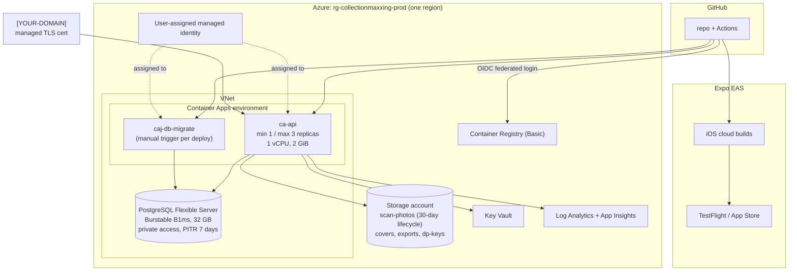

# 10 — Hosting and DevOps

## Why Azure

.NET is first-class there. Managed identity removes most secrets. Aspire models the app and its dependencies for local dev and generates the deployment infrastructure. Entra External ID is an easy fallback for identity, and Container Apps scales to zero when idle. It's the lowest-friction home for a .NET backend. Alternatives (Fly.io, a VPS with Docker Compose, a home server) are listed in [ADR-008](12-decision-log.md#adr-008-azure-container-apps-hosting).

## Production topology



| Resource | SKU / setting | Why |
|---|---|---|
| Container Apps (Consumption) | 1 vCPU / 2 GiB, **min replicas 1** in prod | Avoids cold starts on sign-in and scanning. The extra headroom is for the in-process image-embedding model (int8 ONNX, ~100 MB on disk, ~300 MB RAM, ~0.2 s per image). Drop to 0.5 vCPU / 1 GiB if load tests show it's enough. Set min replicas to 0 for "budget mode". |
| PostgreSQL Flexible Server | Burstable **B1ms**, 32 GB, v17, PITR 7 days, private access, Entra auth; `azure.extensions` = `PG_TRGM,VECTOR` | Smallest always-on tier is plenty for a household. Even a seeded visual index (~15–35k vectors) is tens of MB. Scale up in place when needed. |
| Storage | StorageV2, LRS, Hot; private containers; lifecycle rules | Photos, covers, exports, Data Protection keys |
| Key Vault | Standard, RBAC mode, soft delete + purge protection | Certificates and third-party keys |
| Container Registry | Basic | Managed-identity image pull (no registry passwords) |
| Log Analytics + App Insights | Pay-as-you-go, 30-day retention, daily cap 1 GB | OpenTelemetry sink |
| Custom domain | Managed certificate on Container Apps (free) | |

## Environments

| Env | Where | Data | Purpose |
|---|---|---|---|
| **Local** | Your PC via **Aspire AppHost** | Postgres + Azurite containers (Docker Desktop) | Daily dev. `dotnet run --project src/CollectionMaxxing.AppHost` starts everything, including the Expo web dev server, and opens the Aspire dashboard (logs, traces, metrics). |
| **CI (ephemeral)** | GitHub Actions runner | Testcontainers | PR checks + Playwright E2E with fakes |
| **Staging revision** | Same Container App, new **revision** at 0% traffic with a `staging` label URL | Prod DB (migrations are expand/contract) | Smoke + ZAP before traffic shifts |
| **Production** | Container Apps | Prod | You |

A separate staging environment with its own database adds about $16/month. That's not worth it for one user. Add it if/when other people use the app.

## Deployment pipeline (on merge to `main`)

```
1. build & test (same as PR)
2. build web (expo export --platform web) → copy into Api/wwwroot
3. dotnet publish /t:PublishContainer → push ACR (tag = git SHA)
4. build EF migration bundle → push as a job image
5. run caj-db-migrate (expand-only migrations) → wait for success
6. deploy new revision of ca-api with 0% traffic, label "staging"
7. smoke tests against the staging label URL (health, sign-in page, authenticated read via a test token)
8. shift traffic 100% → new revision (keep the previous one active for 24 h for instant rollback)
9. post-deploy: availability check + error-rate watch (10 min); auto-rollback on failure
```

**Rollback:** shift traffic back to the previous revision (seconds). Expand/contract migrations keep the old revision compatible with the new schema.

**iOS pipeline (on tag `v*`):** `eas build --platform ios --profile preview` → `eas submit` to TestFlight. Production releases are manual through `eas submit --profile production`. JS-only hotfixes go out with `eas update --channel production`.

## Infrastructure as code

- **Bicep** in `infra/`, deployed with **azd** (`azd provision`, `azd deploy`). It's initially generated from the Aspire app model, then owned and edited by hand.
- One parameter file per environment. No portal click-ops; drift is checked by a weekly `what-if` workflow.
- Bootstrap steps (one-time, documented in `infra/README.md`):
  1. Create the subscription and resource group.
  2. Create the GitHub OIDC federated credential.
  3. Create the Apple Sign-in key.
  4. `azd provision`.

## Observability

| Signal | Tooling | Key items |
|---|---|---|
| Traces | OpenTelemetry → App Insights | One trace per scan from app → API → providers/Claude, with candidate counts and scores as attributes |
| Metrics | OTel meters | `scan.candidates{resolution}`, `provider.latency{provider}`, `provider.errors`, `ai.tokens{direction}`, `ai.cost_usd`, `upc.quota.remaining` |
| Logs | `ILogger` (structured) → App Insights | Redacted; correlation via trace ID |
| Dashboards | Azure Workbook "CollectionMaxxing ops" | Scan funnel, match-rate by provider, AI spend vs budget, p95 latency, errors |
| Uptime | App Insights availability test on `/health/ready` every 5 min | Email/push alert |
| Mobile crashes | Sentry (free tier) via `@sentry/react-native`, **no PII**, or Expo's own crash reporting | Symbolicated iOS crashes |

## Backup and disaster recovery

| | Target | How |
|---|---|---|
| Database RPO | ≤ 5 min | Flexible Server point-in-time restore (7-day window, extendable to 35) |
| Database RTO | ≤ 2 h | PITR to a new server and repoint the connection (scripted in `infra/runbooks/restore-db.md`) |
| Long-term | Weekly `pg_dump` → blob container with a **time-based immutability** policy, 12 weeks | An ACA scheduled job |
| Blobs | Soft delete 14 days + versioning on `covers` and `exports` | Storage settings |
| Your own escape hatch | Export (CSV + JSON) from the app any time | |
| Drill | Restore to a scratch server **before launch**, then yearly | Runbook |

## Cost estimate (monthly, USD, approximate; check with the Azure pricing calculator)

| Item | Estimate |
|---|---|
| Container Apps: 1 always-on replica (1 vCPU / 2 GiB, for the embedding model); partly covered by the monthly free grant | $15–25 |
| PostgreSQL Flexible Server B1ms + 32 GB storage | $15–18 |
| Storage + Key Vault + Container Registry Basic | $6–7 |
| Log Analytics / App Insights (under the free ingestion allowance with a daily cap) | $0–3 |
| Claude API: initial cataloguing (one-off ~$10–25 incl. a few hundred single-item pictures at ~$0.03–0.05), then | $1–5 |
| Metadata APIs (free tiers) | $0 (optional UPCitemdb DEV: $99 for one month of bulk import) |
| Domain | ~$1–2 |
| **Azure + AI total** | **≈ $40–55 / month** |
| Apple Developer Program | $99 / year |
| Expo EAS | Free tier is enough for a solo app (limited build minutes/month) |

**Budget mode (≈ $10–15/month):** Container Apps min replicas 0 (accept ~3–8 s cold starts, including loading the embedding model), Postgres on the Azure free account's 12-month B1ms offer, and GitHub Container Registry instead of ACR.

**Guardrails:** an Azure **budget alert** at $50 and $70, plus the app's own AI budget breaker.

## Local developer setup (Windows)

1. Install the .NET 10 SDK, Node 22 LTS (or the version Expo 57 recommends), Docker Desktop, the Aspire CLI/templates, VS 2026 or Rider, and VS Code.
2. `git clone`, then `dotnet user-secrets set …` for the provider keys (each one is optional; the fakes are used when a key is missing).
3. `dotnet run --project src/CollectionMaxxing.AppHost`. This starts Postgres, Azurite, the API (with migrations applied) and Expo web, and opens the Aspire dashboard.
4. iPhone: install the EAS development build once (`eas build --profile development`), then `npx expo start` and scan the QR code.
5. `dotnet test` runs everything except the evals. Docker must be running for Testcontainers.
