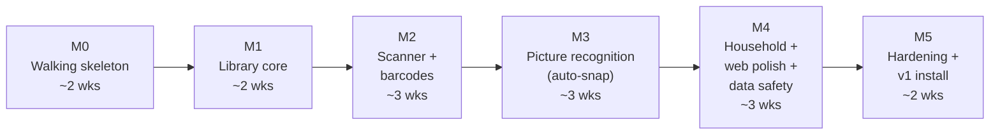

# 11 — Roadmap

Six milestones. Each one ends in something you can **use on your phone**, not just merged code. The sizes assume one developer working part-time with Claude Code.

*(About 15 part-time weeks to v1.0. Treat it as an estimate, not a commitment.)*

---

## M0 — Walking skeleton (≈ 2 weeks)

**Goal:** the thinnest end-to-end slice, deployed. Pair your iPhone and see "Hello, [name]" from the production API on your PC.

- [ ] Git repo (private, GitHub), branch protection, `CLAUDE.md` with the TDD working agreement and links to these docs
- [ ] .NET solution skeleton (`.slnx`, Central Package Management, analyzers, `.editorconfig`), all projects + test projects
- [ ] Architecture tests in place from the first commit
- [ ] Aspire AppHost: Postgres, API, Expo web
- [ ] ASP.NET Core Identity + OpenIddict: **setup code → owner passkey** (web), **QR device pairing** (custom grant) for the iPhone, Face ID app lock
- [ ] `GET /api/v1/me`, with the authorization-matrix harness and every-endpoint-has-a-policy test (already useful with 1 endpoint)
- [ ] Expo app: Router, tabs shell, QR pairing, token storage/refresh, generated API client
- [ ] **Self-hosting on your PC:** update Docker Desktop; `deploy/docker-compose.yml` (api, migrate, postgres, aspire-dashboard, backup); `tailscale serve` HTTPS; secrets folder + ACL; BitLocker check
- [ ] GitHub Actions CI on hosted runners → images to GHCR; **self-hosted runner** on the PC for the `deploy` job only (pull, migrate, restart, smoke, rollback)
- [ ] Nightly backups to F:\ + weekly encrypted off-site copy; heartbeat check
- [ ] **$0 iPhone pipeline:** GitHub Actions macOS workflow → unsigned `.ipa`; AltServer on the PC + AltStore on the iPhone (free Apple ID, weekly auto re-sign); Developer Mode on
- [ ] **Day-one spike:** a throwaway app that calls the on-device Foundation Model with an image, plus Vision barcode/text, built unsigned and installed with your free Apple ID on the iPhone 17 Pro. **If the model isn't available to free-signed apps, we know before building on it**; the Vision text engine becomes primary.
- [ ] Observability: OTel → Aspire Dashboard; rotating log files; `/health/ready` check

**Exit criteria:** a sideloaded build on your iPhone pairs with the server on your PC over Tailscale (including over cellular); CI is green; one merge to `main` deploys with zero manual steps; the day-one spike's answer is recorded.

## M1 — Library core (≈ 2 weeks)

**Goal:** a real, manually populated library on both platforms.

- [ ] Domain: identifiers (GTIN/ISBN), Work/Release/Item, locations, statuses: **TDD from the starter test list**
- [ ] Data model + migrations; global query filters; isolation tests
- [ ] Catalogue search with Open Library + Google Books (books), TMDB (film), IGDB (games); provider cache and rate limiters; WireMock fixtures
- [ ] Items CRUD, filters, sort, search; ETags; soft delete + restore
- [ ] iOS: library grid (shelf baseline), item detail, edit, manual search-and-add
- [ ] Web: library table + grid, item drawer, bulk edit
- [ ] Locations management

**Exit criteria:** you've added 25 real items by search on iOS and web; the authorization matrix covers every endpoint.

## M2 — The scanner + barcodes (≈ 3 weeks)

**Goal:** the core loop. Point at a stack and add it.

- [ ] VisionCamera v5 + the first piece of `cm-vision`: the Apple Vision barcode frame plugin; `ScannerSource` seam + `FakeScannerSource`
- [ ] Receipt tray: stability filter, de-dupe, +1 copy, offline queue (MMKV), haptics/sound
- [ ] Scan sessions, `POST /barcodes` with idempotency, resolution pipeline (local → OL/GB → UPCitemdb → normaliser → IGDB/TMDB), scorer
- [ ] UPC quota tracking + Pending + nightly retry job
- [ ] SSE events + polling fallback
- [ ] Review screen (groups, bulk "Add to", pick-one, not-found search); commit; undo
- [ ] Duplicate detection; ownership on every result ("You own this")
- [ ] Close-scanner sheet: Review / Keep for later / Discard
- [ ] Learning loop: confirmed barcode → release
- [ ] Maestro E2E: scan 6 fake codes → review → commit

**Exit criteria:** catalogue one real box of 40+ games/DVDs in under 5 minutes; auto-match rate measured and recorded.

## M3 — Picture recognition: auto-snap, single items, shelves (≈ 3 weeks)

**Goal:** anything without a barcode (shelves of spines, loose cartridges, VHS sleeves and tapes, discs), using **only Apple frameworks on the iPhone**.

- [ ] **Spike (first 2–3 days, on your iPhone 17 Pro):**
  - the Foundation Models image call with `@Generable` output on 20 golden photos: accuracy after grounding, latency, refusals, thermals, context fit;
  - Vision OCR on rotated spines;
  - feature-print distances for original vs re-release artwork.

  Apply the gate in [02](02-scanning-and-recognition.md#the-m3-gate-run-on-your-iphone-17-pro).
- [ ] **`cm-vision` module** (Swift, thin): `readItems` (streamed), `recognizeText` at 0/90/270°, `detectRectangles`, `featurePrint` + `distance`; a TS `VisionEngine` interface + `FakeVisionEngine` fixtures
- [ ] **Auto-snap** state machine (steady, sharp, text/rectangle present, new view; barcodes win) + manual shutter
- [ ] **Apple model engine** (primary) and a lean **Vision text engine** (fallback: OCR + rectangles + simple splitting) behind the `RecognitionEngine` interface, with per-snap fallback rules
- [ ] Item boxes from Vision text matched to the model's items; feature prints of your confirmed items (local store + backup) for instant repeats
- [ ] `/identify` (text only) + `:art` re-scoring for close calls (the phone compares candidate artwork thumbnails)
- [ ] Result cards over the camera, "Nice scan!", processing chip, status bar; result detail with the item **highlighted** and Wrong item? Fix it
- [ ] Import from Photos (multi-select, same on-device pipeline)
- [ ] On-phone **Run evals** screen (dev builds) that uploads results; golden set: 40–60 shelf photos + 60–100 single items (loose carts per platform, VHS sleeves, bare tapes, boxes, discs) with truth files

**Exit criteria:**

- Shelf eval: recall ≥ 85% and precision ≥ 90%.
- Single-item eval: top-1 accuracy meets the per-kind targets in [02 §5](02-scanning-and-recognition.md#5-single-items-recognising-one-thing-from-its-picture), or the gaps are documented with a plan.
- You've catalogued at least 3 real shelves and a box of loose carts without touching anything but Review.
- Auto-snap misfires (pictures with nothing found) under 10% in a real session.

## M4 — Household sharing, web polish and data safety (≈ 3 weeks)

- [ ] **Household sharing:**
  - invites on the web (Editor/Viewer, link + QR code, single use, 7 days, revocable);
  - the `/join` page with passkey creation;
  - the Members page (change role; remove → devices revoked);
  - "Added by" on items;
  - the conflict prompt when two people edit the same item ("Sam changed this. Reload?").
- [ ] **Family onboarding:**
  - Tailscale invite + an ACL that allows only the PC's HTTPS port;
  - AltStore with their own Apple ID on your AltServer;
  - **Settings → Get the iPhone app** (latest `.ipa` served by your PC);
  - a one-page guide.

- [ ] Export (CSV + JSON zip) through a background job
- [ ] Account deletion (fresh passkey, revoke all devices and sessions, purge job)
- [ ] **Offline "do I own this?" cache** on the phone (owned identifiers, titles, feature prints), synced, so checks work when the PC is off
- [ ] Signed-in devices list + revoke
- [ ] Recently deleted bin; audit events
- [ ] Settings → Recognition (active engine, Apple Intelligence status) and Security (Face ID lock, unpair)
- [ ] Web table polish: column chooser, inline edits, range select
- [ ] Accessibility pass (VoiceOver, Dynamic Type, contrast)

**Exit criteria:** a family member joins by invite, pairs their own iPhone and scans into the shared library; a Viewer can check ownership but can't change anything; you could lose your phone **and** the PC's main drive and still have your data (restore from F:\ and from the off-site copy both tested); the accessibility checklist passes.

## M5 — Hardening and v1 on your iPhone (≈ 2 weeks)

- [ ] ASVS L2 checklist walkthrough; ZAP baseline clean; manual auth-flow abuse tests
- [ ] Restore-from-backup drill
- [ ] Load sanity check (k6): 20 concurrent scanners for 10 minutes on the PC (while a game is running), p95 < 500 ms
- [ ] Privacy manifest; a short privacy note in the About screen
- [ ] Provider attribution (TMDB, IGDB) on the About screen
- [ ] v1.0 build installed via AltStore with background re-signing confirmed over a couple of weeks; Tailscale VPN On Demand; a family member's iPhone re-signing through the same AltServer

**Exit criteria:** v1.0 on your iPhone (sideloaded, auto re-signing), used for a real week of cataloguing at home and out (thrift store over cellular via Tailscale), with no data-loss scares.

---

## After v1.0

| Release | Items |
|---|---|
| **v1.1** | CSV import (generic, Goodreads, CLZ, LibraryThing), lending reminders, stats, photo tiling for dense shelves (if the evals call for it) |
| **v2** | Public share links, Android, music formats (Discogs), widgets/App Intents |

## Risks and mitigations

| Risk | Likelihood | Impact | Mitigation |
|---|---|---|---|
| UPC → title coverage for DVDs/games is poorer than hoped | Medium | Medium | Cover-photo fallback; learning loop; optional paid UPC plan for one month; measure in M2 before investing more |
| AI recall on dense/dim shelves is poor | Medium | Medium | Eval-driven prompt work; tiling; capture guidance (torch, closer shots); barcodes still cover most cases |
| Worn cart labels the model can't read | Medium | Medium | Platform from the shell shape still scores; your confirmed carts match instantly next time; otherwise Fix it |
| Apple-only means no catalogue-wide image search | Low | Low | Rarely needed when the model can read labels; Fix it with the read text pre-filled; the evals quantify it |
| Apple model: guardrail refusals (e.g. horror VHS covers), behaviour changes across iOS releases | Medium | Medium | Lean Vision text engine as the automatic per-snap fallback; the gate is measured on your iPhone 17 Pro; evals re-run each iOS release |
| Free Apple ID limits (7-day signatures, 3 apps, no paid capabilities) or Apple changing sideloading rules | Medium | Medium | AltStore auto re-signs nightly at home; plan avoids paid capabilities; if it ever becomes unworkable, the $99 membership (TestFlight) is a drop-in fallback with no code changes |
| On-device Foundation Model unavailable to free-signed apps | Low–Medium | High | Day-one spike in M0; the Vision text engine is the fallback primary |
| GitHub's free macOS minutes run out (~8–12 builds/month) | Low | Low | Build only for native changes/releases; JS iterates on the dev server; a public repo would make minutes unlimited |
| Native Swift module on a Windows machine | Medium | Medium | Keep `cm-vision` thin (wrappers only, no logic) behind a TS interface with a fake; GitHub's macOS runner compiles it; fixture JSON captured from your iPhone drives the tests |
| Provider terms change (IGDB commercial terms, TMDB) | Low (personal use) | Medium | Provider interface makes swaps local; cached data keeps working |
| PC off, asleep or rebooting when you're out | Medium | Low | Scanning and "do I own this?" work on the phone; matches queue and resolve later; D13 (keep it awake); same compose file can move to a mini PC |
| Home server hygiene (backups, updates, disk failure) | Medium | High | Nightly backups to a second drive + weekly encrypted off-site copy, heartbeat alerts, restore drills, BitLocker |
| Scope creep (music, value, social) | High | Medium | v1 scope is locked in [00](00-product.md); everything else goes to the v1.1/v2 lists |
| Owning the auth server is too much | Low | Medium | OpenIddict covers the hard parts; the attack surface is small because the server is tailnet-only |
