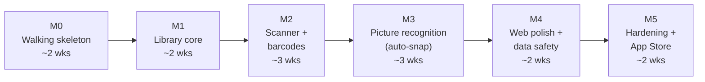

# 11 — Roadmap

Six milestones. Each one ends in something you can **use on your phone**, not just merged code. The sizes assume one developer working part-time with Claude Code.

*(About 14 part-time weeks to v1.0. Treat it as an estimate, not a commitment.)*

---

## M0 — Walking skeleton (≈ 2 weeks)

**Goal:** the thinnest end-to-end slice, deployed. Sign in on your iPhone and see "Hello, [name]" from the production API.

- [ ] Git repo (private, GitHub), branch protection, `CLAUDE.md` with the TDD working agreement and links to these docs
- [ ] .NET solution skeleton (`.slnx`, Central Package Management, analyzers, `.editorconfig`), all projects + test projects
- [ ] Architecture tests in place from the first commit
- [ ] Aspire AppHost: Postgres, Azurite, API, Expo web
- [ ] ASP.NET Core Identity + OpenIddict + **Sign in with Apple** (web + iOS via the auth sheet)
- [ ] `GET /api/v1/me`, with the authorization-matrix harness and every-endpoint-has-a-policy test (already useful with 1 endpoint)
- [ ] Expo app: Router, tabs shell, sign-in, token storage/refresh, generated API client
- [ ] Bicep + azd: provision prod; GitHub Actions CI + CD (revision deploy, smoke, traffic shift); OIDC to Azure
- [ ] EAS: development build on your iPhone, TestFlight build
- [ ] Apple Developer membership, App ID, Sign in with Apple key, associated domains
- [ ] Observability: OTel → App Insights; availability test; budget alerts

**Exit criteria:** a TestFlight build signs you in against production; CI is green and under 12 minutes; one merge to `main` deploys with zero manual steps.

## M1 — Library core (≈ 2 weeks)

**Goal:** a real, manually populated library on both platforms.

- [ ] Domain: identifiers (GTIN/ISBN), Work/Release/Item, locations, statuses: **TDD from the starter test list**
- [ ] Data model + migrations; global query filters; isolation tests
- [ ] Catalogue search with Open Library + Google Books (books), TMDB (film), IGDB (games); provider cache and rate limiters; WireMock fixtures
- [ ] Items CRUD, filters, sort, search; ETags; soft delete + restore
- [ ] iOS: library grid (shelf baseline), item detail, edit, manual search-and-add
- [ ] Web: library table + grid, item drawer, bulk edit
- [ ] Locations management

**Exit criteria:** you've added 25 real items by search on iOS and web; the authorization matrix covers every endpoint.

## M2 — The scanner + barcodes (≈ 3 weeks)

**Goal:** the core loop. Point at a stack and add it.

- [ ] VisionCamera v5 + ML Kit barcode scanner; `ScannerSource` seam + `FakeScannerSource`
- [ ] Receipt tray: stability filter, de-dupe, +1 copy, offline queue (MMKV), haptics/sound
- [ ] Scan sessions, `POST /barcodes` with idempotency, resolution pipeline (local → OL/GB → UPCitemdb → normaliser → IGDB/TMDB), scorer
- [ ] UPC quota tracking + Pending + nightly retry job
- [ ] SSE events + polling fallback
- [ ] Review screen (groups, bulk "Add to", pick-one, not-found search); commit; undo
- [ ] Duplicate detection; ownership on every result ("You own this")
- [ ] Close-scanner sheet: Review / Keep for later / Discard
- [ ] Learning loop: confirmed barcode → release
- [ ] Maestro E2E: scan 6 fake codes → review → commit

**Exit criteria:** catalogue one real box of 40+ games/DVDs in under 5 minutes; auto-match rate measured and recorded.

## M3 — Picture recognition: auto-snap, single items, shelves (≈ 3 weeks)

**Goal:** anything without a barcode: shelves of spines, loose cartridges, VHS sleeves and tapes, discs.

- [ ] Upload pipeline: validation, re-encode/EXIF strip, model-native resize, blob storage, job queue
- [ ] ZXing.Net multi-decode on stills
- [ ] Claude client (official C# SDK): structured outputs, prompt v1 (versioned + snapshot-tested), refusal handling, `ai_usage` accounting, budget breaker, per-user limits
- [ ] **Auto-snap** state machine (steady, sharp, text/rectangle present, new view; barcodes win; misfire back-off) + manual shutter
- [ ] Server routing: one item vs many from Claude's `view` + box output; "nothing found" handling
- [ ] Result cards over the camera (newest first, ownership or + Add / Wishlist), "Nice scan!" confirmation, processing chip and status bar
- [ ] Result detail: your photo with the item **highlighted** (on-device OCR boxes matched to Claude's read; model box fallback), swipe between items in the same photo, Wrong item? Fix it
- [ ] Import from Photos (multi-select)
- [ ] **Visual index:** `IImageEmbedder` (ONNX Runtime, int8 model), pgvector table + HNSW index, embed-on-cache job, fast path for confirmed photos, model-version re-index job
- [ ] **Seeding job** for the platforms you collect (IGDB box art); optional TMDB poster seed
- [ ] **Visual tie-break** call (your photo + candidate artwork) with structured output
- [ ] Single-item eval set: 60+ single-item photos (loose carts per platform, VHS sleeves, bare tapes, boxes, discs), with top-1/top-3 recorded per kind
- [ ] **Eval suite:** 40–60 golden photos of your shelves with truth files; baseline recorded; effort-level comparison
- [ ] Web: drag-and-drop multi-photo scan

**Exit criteria:**

- Shelf eval: recall ≥ 85% and precision ≥ 90%.
- Single-item eval: top-1 accuracy meets the per-kind targets in [02 §5](02-scanning-and-recognition.md#5-cover-recognition-identify-one-item-from-its-picture), or the gaps are documented with a plan.
- You've catalogued at least 3 real shelves and a box of loose carts without touching anything but Review.
- Auto-snap misfires (pictures with nothing found) under 10% in a real session.

## M4 — Web polish and data safety (≈ 2 weeks)

- [ ] Export (CSV + JSON zip) through a background job
- [ ] Account deletion (re-auth, Apple token revocation, purge job)
- [ ] Signed-in devices list + revoke
- [ ] Passkeys (web)
- [ ] Recently deleted bin; audit events
- [ ] Settings: delete scan photos after adding
- [ ] Web table polish: column chooser, inline edits, range select
- [ ] Accessibility pass (VoiceOver, Dynamic Type, contrast)

**Exit criteria:** you could lose your phone and your Azure subscription and still have your data (export tested); the accessibility checklist passes.

## M5 — Hardening and App Store (≈ 2 weeks)

- [ ] ASVS L2 checklist walkthrough; ZAP baseline clean; manual auth-flow abuse tests
- [ ] Restore-from-backup drill
- [ ] Load sanity check (k6): 20 concurrent scanners for 10 minutes on B1ms, p95 < 500 ms for non-AI endpoints
- [ ] Universal-link auth callback; privacy manifest; privacy policy and terms pages; App Store screenshots
- [ ] Provider attribution (TMDB, IGDB) on the About screen
- [ ] App Store submission (Sign in with Apple ✓, account deletion ✓, camera purpose string ✓)

**Exit criteria:** v1.0 approved on the App Store (or TestFlight-only if you'd rather keep it private; App Store review is optional for personal use).

---

## After v1.0

| Release | Items |
|---|---|
| **v1.1** | Household sharing (invites, roles in the UI), Google sign-in, native Apple sheet (token exchange), CSV import (generic, Goodreads, CLZ, LibraryThing), lending reminders, offline "you own this" for barcodes, stats, photo tiling for dense shelves (if the evals call for it) |
| **v2** | Public share links, Android, music formats (Discogs), widgets/App Intents, on-device OCR pre-pass |

## Risks and mitigations

| Risk | Likelihood | Impact | Mitigation |
|---|---|---|---|
| UPC → title coverage for DVDs/games is poorer than hoped | Medium | Medium | Cover-photo fallback; learning loop; optional paid UPC plan for one month; measure in M2 before investing more |
| AI recall on dense/dim shelves is poor | Medium | Medium | Eval-driven prompt work; tiling; capture guidance (torch, closer shots); barcodes still cover most cases |
| Loose-cart photos don't look like box art, so visual matching is weak at first | Medium | Medium | Lower visual weight for carts and more weight on Claude's label reading and the shell shape; every confirmed cart photo improves the index; the tie-break call compares artwork directly |
| Provider terms change (IGDB commercial terms, TMDB) | Low (personal use) | Medium | Provider interface makes swaps local; cached data keeps working |
| Apple review friction | Low | Low | Requirements built in from M0; TestFlight-only is an acceptable fallback for personal use |
| Scope creep (music, value, social) | High | Medium | v1 scope is locked in [00](00-product.md); everything else goes to the v1.1/v2 lists |
| Owning the auth server is too much | Low | Medium | OpenIddict covers the hard parts; the Entra External ID swap is a contained change (D2) |
