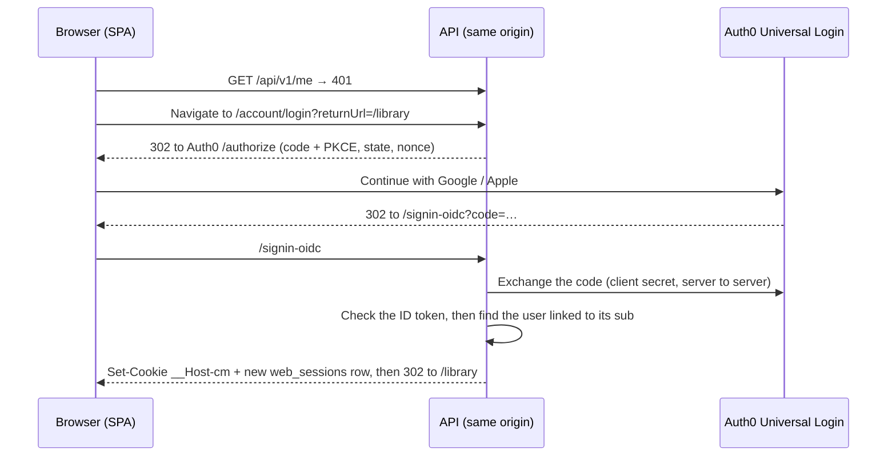
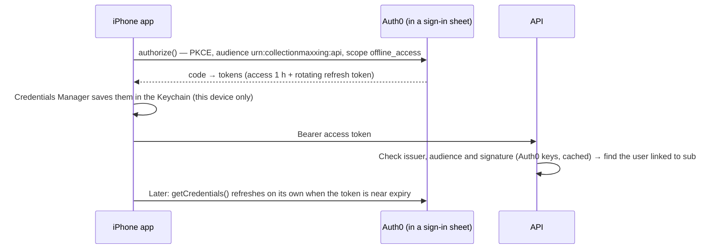
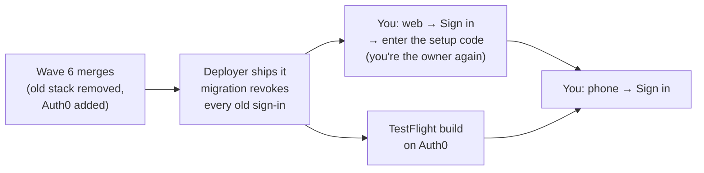

# 14 — Moving sign-in to Auth0 (plan)

**Status:** Proposed, 2026-10-22. It needs your OK on the [decisions](#decisions-for-you) before any code changes. The decision record is [ADR-025](12-decision-log.md#adr-025-auth0-for-sign-in-our-api-keeps-authorization). Once this ships, [07](07-authentication-and-authorization.md) is rewritten to match and this plan is archived.

## Summary

| | Today | After |
|---|---|---|
| Who signs people in | Our API: OpenIddict 7 + ASP.NET Identity passkeys | **Auth0** (free plan), Universal Login |
| Ways to sign in | A passkey on the web; a QR pairing on the iPhone | **Google** and **Sign in with Apple**, on both. More providers are one config line each. |
| Web | Passkey, then the `__Host-cm` cookie (8 h idle, 30 days max) | Auth0 sign-in, then **the same `__Host-cm` cookie** (30 days idle, 1 year max). The browser never holds a token. |
| iPhone | QR pairing; custom `urn:cm:device_pairing` grant; our refresh code | **Authorization Code + PKCE** with Auth0's SDK. The rotating refresh token is in the Keychain and refreshes itself. |
| Who can get in | Setup code, invites, pairing | Unchanged: **setup code for the owner, invites for family.** An Auth0 identity that isn't linked to a user gets nothing. |
| Authorization | Deny by default, library roles, authorization matrix | **Unchanged** |
| Token keys | Our PFX certificates, rotated yearly by hand | Auth0's keys, rotated by Auth0. Our certificates are deleted. |
| Cost | $0 | **$0**: Auth0 Free, a Google OAuth client, and Sign in with Apple (included in the Apple membership) |
| Old sign-ins | — | **All revoked at the cutover**, in one release with no transition period. Everyone signs in fresh ([cutover](#cutover-one-release-everything-old-revoked)). |
| Your setup time | — | **About 30 minutes, once**, plus signing in once on each device ([what you do](#what-you-do)) |

## What I found

The current system is careful, but it's all ours to run: about 4,700 lines of auth code across the API, Application and Infrastructure projects, about 1,800 in the app (with its tests), and 35 backend test files that depend on it.

- **Logins don't last.** On the web, the cookie dies after **8 idle hours**, so most days start with a passkey prompt. The iPhone keeps a 90-day refresh token, but anything that loses it means pairing again with a fresh QR code from the web: a reinstall, the TestFlight move (ADR-024), or a revoked chain. The Face ID app lock after 5 minutes away also feels like signing in again.
- **No standard OAuth.** The phone signs in through a custom grant (`urn:cm:device_pairing`) on our own OpenIddict server. Nothing else can sign in that way, and we own the token server, its PFX keys, their yearly rotation, refresh-token rotation, and the replay rules (and the flaky race test in #205).
- **No social sign-in.** docs/07 rules out third-party identity providers on purpose ("no Sign in with Apple, pairing covers it").
- **Scaling is manual.** Each new kind of client (a second phone, an iPad, a family member) goes through our own ceremony code.

ChoreApp's setup (JWT bearer with Auth0 authority and audience, then mapping the Auth0 user id to our own user id) is the right core idea, and this plan reuses it. It changes three things:
- the mapping lives in a proper link table, not a cached lookup;
- the web uses a server-side session instead of tokens in the browser;
- there's no CORS at all.

## What stays the same

Most of the system doesn't change, which keeps the work small:

- **Authorization:** the deny-by-default fallback policy, `RequireLibraryRole`, `LibraryMembershipFilter`, the EF library filter, the authorization-matrix and IDOR tests.
- **The test sign-in** (`TestAuthHandler`, the `X-Test-User` header). About 200 API test files don't change.
- **Our users:** the `users` table, its GUID ids, memberships, the "added by" history and invites. Auth0 only proves *who* someone is; our database still decides *what* they can do. The Free plan has no role management anyway.
- **The web session model:** the `__Host-cm` cookie, `web_sessions` rows (revocable, listed in Settings), the `X-CSRF` header, and no CORS.
- **The deactivation check** on every request. A removed member is locked out on their next call, whatever token they hold.
- **Tailscale** as the outer wall, and the **Face ID app lock** on the iPhone.

## Target design

### What lives in Auth0

All of it is kept as configuration in the repo (`deploy/auth0/`), with placeholders for the hostnames and secrets. A script applies it ([below](#how-it-stays-hands-off)).

| Auth0 object | Type | Settings |
|---|---|---|
| CollectionMaxxing API | API (resource server) | Identifier `urn:collectionmaxxing:api`, RS256, 1-hour access tokens, refresh tokens allowed |
| CollectionMaxxing Web | Regular Web Application (confidential) | Code flow. Callback `https://pc.tailnet.ts.net/signin-oidc` and `http://localhost:5480/signin-oidc` for development. Sign-out returns to the same hosts. |
| CollectionMaxxing iPhone | Native | Code + PKCE. Callback `io.github.coryfinnegan.collectionmaxxing.auth0://<tenant>/ios/io.github.coryfinnegan.collectionmaxxing/callback`. Refresh-token rotation, 90 days idle, 1 year max. |
| CollectionMaxxing Server | Machine to Machine | Management API scopes `read:users`, `delete:users` and `delete:refresh_tokens` only, for revoking phones and deleting accounts |
| Google, Apple | Social connections | Enabled for the web and iPhone apps only |
| Username and password database | — | **Off.** It would need an email provider, and avoiding passwords was the point of passkeys. |
| Tenant | Settings | Brute-force protection on, Universal Login branded with our name, logo and colours, no Actions needed |

**Tailnet:** Auth0 never has to reach the PC. Every redirect runs through the browser or the phone, both already on your tailnet. The API only makes outbound calls to Auth0: the signing keys (cached) and the web code exchange.

### Web: Auth0 signs you in, our cookie keeps you in

- **Handler:** Microsoft's own `AddOpenIdConnect`, with no Auth0 SDK, so the API speaks plain OIDC. Moving to another provider later is configuration.
- **No tokens in the browser:** the ID token is checked and thrown away (`SaveTokens = false`). After that, it's the same cookie, CSRF header and `web_sessions` row as today.
- **Lifetime:** the cookie becomes **30 days sliding, 1 year at most** (D-2). Auth0's own session only matters the next time you press Sign in.
- **Recent sign-in:** for the actions that need one today (invites, deleting an account), `RequireRecentPasskey` becomes `RequireRecentSignIn`. The app sends you through `/account/login?reauth=1`, which asks Auth0 for `max_age=0`. The API accepts the ID token's `auth_time` only if it's under 5 minutes old.
- **Sign out:** revoke the `web_sessions` row, clear the cookie, then send the browser to Auth0's `/v2/logout`, so the next sign-in shows the account picker again. The CSP's `form-action` gets the Auth0 domain for this one redirect.
- **Public origin:** the `redirect_uri` comes from configuration (`Auth:PublicOrigin`), not from the request's host. This closes the "issuer from the request host" gap from Wave 4.

### iPhone: Auth0's SDK and the Keychain

- **SDK:** `react-native-auth0` v5 with its Expo config plugin. It needs a development build, which we already make. It's not compatible with Expo Go, which we don't use.
- **Sign-in:** a single Sign in button. It opens iOS's standard sign-in sheet (`ASWebAuthenticationSession`), where you pick Google or Apple. iOS shows its usual "CollectionMaxxing wants to use auth0.com to sign in" prompt first.
- **What gets deleted:** `tokenStore.ts`, the refresh, back-off and revoke code in `session.ts`, the pairing screen, QR scanning and 6-digit codes. The Credentials Manager handles storage, refresh and thread safety.
- **API side:** Microsoft's `AddJwtBearer` checks the issuer (your Auth0 tenant), the audience and the signature. The `api` scope check becomes the audience check.
- **Finding the server:** today the QR code carries the server address. The TestFlight build will carry it instead, from a secret in the `testflight` environment (D-4).
- **Face ID app lock:** it stays as it is (D-6).

### Linking Auth0 identities to our users

- A new `user_logins` table holds `user_id`, `provider` (`auth0`), `subject` (Auth0's `sub`, such as `google-oauth2|…` or `apple|…`) and `created_at`, with `subject` unique.
- One person can link **both** Google and Apple: Settings → Sign-in methods → Add. Removing the last one is blocked.
- The API never matches people by email. An address from a provider isn't proof of who someone is. Email is stored for display only.
- **An identity that isn't linked gets in only through one of these paths.** Anyone else sees "This account isn't part of a library. Ask the owner for an invite", and nothing is created.

| Path | When | What happens after the Auth0 sign-in |
|---|---|---|
| **Setup** | No user has a linked identity yet: a fresh install, or right after the cutover | Enter the setup code. The identity becomes the owner. If an owner row already exists (yours, with your library), it's claimed; otherwise one is created. |
| **Invite** | `/join/{token}` | The invite token sits in a short-lived protected cookie during the Auth0 round trip. Then the user and membership are created, exactly as now. |
| **Add a sign-in method** | Already signed in, with a recent sign-in | The new identity is linked to you, so one person can use both Google and Apple. |
| **Recovery code** | You've lost access to every linked identity | `cm-admin recovery-code` on the PC, as today. The code links the new identity to the owner. |

### Devices and revocation

- **Browsers:** no change (`web_sessions`).
- **iPhones:** after sign-in, the app registers itself (`POST /api/v1/me/app-sign-ins` with the device name), so Settings → Devices can list it with its last-seen time.
- **Revoke an iPhone:** the API calls Auth0's Management API to delete that person's refresh tokens, and sets `users.tokens_not_before = now`. Any access token issued before then is refused at once. Auth0 may only allow revoking all of a person's phones together, not one; AUTH0-0 checks this on the Free plan.
- **Remove a member:** the existing deactivation check, plus revoking their refresh tokens.
- **Delete an account:** as today, plus deleting the person's Auth0 user, so nothing is left at Auth0.

### Keys and secrets after the move

| Secret | Where | Notes |
|---|---|---|
| Web app client secret | PC secrets folder (`.env`), mounted into the API | Rotate from the script whenever you like |
| Server M2M client id and secret | PC secrets folder | Only the three Management API scopes above |
| Google OAuth client secret, Apple `.p8` key | In Auth0, with copies in the PC secrets folder (`secrets\auth0\`) so the script can rebuild the tenant | The Apple key doesn't expire; the Google secret doesn't either |
| Provisioner M2M credentials | PC secrets folder (`secrets\auth0\provisioner.env`) | Lets agents change Auth0 without you (D-5) |
| Auth0 domain, client ids, server URL | `.env` on the PC, and `testflight` environment secrets for the iPhone build | Not really secret, but they name your tenant and PC, and the repo is public |
| Data Protection key ring | Unchanged | Still seals the cookie |
| ~~OpenIddict signing and encryption PFX~~ | Deleted at the cutover | No more yearly certificate rotation |

## How it stays hands-off

### Tooling

| Tool | Used for | Why |
|---|---|---|
| **Auth0 CLI** (`auth0.exe`) | Everything in the tenant: apps, the API, connections, tenant settings, branding, and raw Management API calls | It's the only tool that covers connections and tenant settings. It's a portable `.exe` in `C:\CollectionMaxxing\tools\auth0\`, like the portable `gh`, so there's no installer, no admin and no PATH change. |
| **`deploy/auth0/` + `Apply-Auth0.ps1`** | Tenant configuration as code: JSON bodies with `{{PLACEHOLDERS}}` filled from the PC's secrets. A dry run by default, `-Apply` to change things, safe to re-run. | Same pattern as `Deploy-CollectionMaxxing.ps1`. Every later Auth0 change is a reviewed PR plus a re-run, not a click in the dashboard. |
| **Auth0 agent skills** (the `auth0` plugin) | Builder agents get Auth0's own guidance for ASP.NET Core and Expo | Free. It cuts the chance of SDK misuse. |
| **Auth0 MCP server** | Optional, **read-only**: reading Auth0 logs while debugging a sign-in | It can create apps and APIs but **not connections, roles or tenant settings**, and it's in beta. The CLI does all of setup. |

### What you do

About 30 minutes in total. Steps 3 and 4 can wait: Auth0's developer keys let us test Google sign-in on day one.

1. **Create a free Auth0 account and tenant** at auth0.com (no card; region US). Tell me the tenant domain (`<tenant>.us.auth0.com`). About 3 minutes.
2. **Approve one sign-in.** I run `auth0 login`, and you confirm the code it shows in your browser. That's 1 minute. I then create the provisioner M2M app and apply the whole configuration, and you don't log in to Auth0 again.
3. **Google sign-in keys,** about 10 minutes, in Google Cloud Console:
   - Create a project and an OAuth consent screen ("External", app name, your support email).
   - Create a **Web** OAuth client with redirect URI `https://<tenant>.us.auth0.com/login/callback`.
   - Save the client id and secret to `C:\CollectionMaxxing\secrets\auth0\google.env`.
   - Or I can click through it in the built-in browser while you're signed in to Google.
4. **Sign in with Apple key,** about 10 minutes, at developer.apple.com:
   - A **Services ID** (`io.github.coryfinnegan.collectionmaxxing.signin`) with Sign in with Apple, and the same Auth0 callback as the return URL.
   - A **key** with Sign in with Apple. Download the `.p8` once into `C:\CollectionMaxxing\secrets\auth0\`.
   - Note the Key ID and Team ID.
   - Same browser offer as step 3.
5. **After the cutover:**
   - On the web, press Sign in and choose Google or Apple.
   - Enter the new setup code from `C:\CollectionMaxxing\secrets\setup-code.txt`. You're the owner again, with your library.
   - That's 2 minutes.
6. **On the phone:** install the TestFlight update and press Sign in once. 1 minute.

You also approve the PRs, as usual: the new packages and the `testflight` secrets are hot-file changes.

## Cutover: one release, everything old revoked

The app hasn't had real use yet, so there's no gradual move. There are no two systems side by side and no linking of old accounts. One release removes the old sign-in and brings in Auth0, and everyone starts fresh.

**Removed in the same release:**
- OpenIddict: the token endpoint, the custom pairing grant, refresh rotation and the PFX certificates. The Data Protection key ring stays, because it still seals the cookie.
- Passkey ceremonies, the passkey store, `RecentPasskey`, the ceremony cookie, and the passkey screens on the web.
- Pairing: QR codes, 6-digit codes, `PairingAttemptLimiter`, the pairing screen and the app's own refresh code.
- The certificates' entries in `docker-compose.yml` and `.env`. The files themselves are deleted from the PC's secrets folder.
- The old endpoints, from the contract too. The snapshot is updated in the same PR, with the reason.
- docs/07 is rewritten, and docs/08, 03, 04 and 10 are updated.
- #205 closes, since its test goes away.

**The migration revokes everything** in one step:
- It drops `user_passkeys`, `device_pairings` and the OpenIddict tables (`openiddict_*`).
- It revokes every `web_sessions` row, so every existing cookie stops working.
- It deletes all `setup_codes` and every pending `library_invites` row.

**Who survives:** the **owner's user row**, with your library and anything you've scanned. The first setup-code sign-in claims it (D-7). Any other account loses its membership; invite them again. If you'd rather start from an empty database too, that's a single restore-to-empty step during the cutover (D-7).

**Old app builds** stop working at the cutover: their refresh tokens are gone, and the pairing screen has nothing to talk to. The TestFlight build on Auth0 goes out from the same `main` commit.

## Work breakdown (Wave 6)

| Task | Tier | Depends on | Scope |
|---|---|---|---|
| **AUTH0-0** | Lead + you | — | Tenant, CLI login, `deploy/auth0/` + `Apply-Auth0.ps1`, provisioner, Google and Apple connections. Check on Free that Management API refresh-token revocation works (per token or per user). |
| **AUTH-1** | Opus, critical, verifier | AUTH0-0 config names | API, **replace in place**: delete OpenIddict, passkeys, pairing and their tests. Add OIDC sign-in for the web (`/account/login`, `/signin-oidc`, `/account/logout`), JWT bearer as the only bearer scheme, `user_logins` with the four link paths (setup claims the existing owner), `RequireRecentSignIn`, the unlinked-identity problem (`account.not_linked`), and authorization-matrix rows. Tests use a **WireMock fake Auth0** (discovery, JWKS, token endpoint) and JWTs signed with a test key. |
| **AUTH-2** | Sonnet | AUTH-1 | `IIdentityProviderAdmin` port and Auth0 adapter (revoke refresh tokens, delete user; M2M token cached), `app_sign_ins`, `tokens_not_before`, wiring into Devices, member removal and account deletion. WireMock tests. |
| **APP-A1** | Sonnet | AUTH-1 contract | Web: delete the passkey screens. Add the Sign in page (one button), the "not part of a library" page, Settings → Sign-in methods, re-auth by redirect, and the setup and join screens adapted. Playwright against the fake Auth0. |
| **APP-A2** | Sonnet | AUTH-1 contract, lead's package PR | iPhone: delete pairing, QR, `tokenStore` and the refresh code. Add `react-native-auth0`, the sign-in screen, the Credentials Manager in `http.ts`, sign out and app registration. At most 3 iOS builds. |
| **Lead** | — | — | Hot files: add `Microsoft.AspNetCore.Authentication.OpenIdConnect` + `JwtBearer` (both Microsoft, 10.0.x) and remove `OpenIddict.*`; add `react-native-auth0`, the `app.config.ts` plugin, compose environment (certificates out, Auth0 in), CSP `form-action`, `testflight` secrets, the **cutover migration**, ADR-025, docs. |

AUTH-1, APP-A1 and APP-A2 run in parallel once the contract is agreed.
- Because the deployer ships every push to `main`, builders open their PRs against an integration branch, **`w6/auth0`**, not `main`.
- The lead merges `w6/auth0` into `main` in **one PR**. That PR is the cutover deploy, and the TestFlight build comes from the same commit. That's one wave, roughly **1 day of agent time**: less than before, with no dual-stack code and no linking of old accounts.

## Risks and trade-offs

- **Signing in needs the internet and Auth0.** A browser that's already signed in doesn't, because the cookie is ours. A phone needs Auth0 once an hour to refresh. Today everything works on a LAN with no internet.
- **Auth0 holds names and emails** (from Google or Apple; Apple can hide the email). Library data never leaves the PC. docs/08 is updated, and account deletion deletes the Auth0 user.
- **Free plan limits:** 25,000 monthly users, no MFA, no role management, 5 Actions, logs kept for 1 day. None of these matter here: we don't use roles or Actions, and Google and Apple do their own MFA.
- **If Auth0 changes its free plan:** the API speaks plain OIDC and JWT, so moving to another provider is configuration plus each person linking once.
- **Anyone can open your Auth0 sign-in page and create an identity.** It gets them nothing: the API admits only linked identities, and the PC is only on your tailnet.
- **Revoking one phone among several** may not be possible on Free (see AUTH-2). The fallback signs out all of that person's phones.
- **Everyone is signed out at the cutover,** and old app builds stop working. That's the point: nobody has used it in earnest yet.
- **One more native dependency** (`react-native-auth0`). It's Auth0's own and supports Expo 57 / React Native 0.86 development builds.

## Decisions for you

| | Question | Default |
|---|---|---|
| D-1 | Which sign-in methods? | **Google + Apple.** Microsoft and GitHub can be added later with one line each. No passwords. |
| D-2 | How long do you stay signed in? | **Web: 30 days since you last used it, 1 year at most. iPhone: 90 days since last use, 1 year at most.** |
| D-3 | Native Sign in with Apple sheet on the iPhone? | **Not now.** The Apple button inside the sign-in sheet works. The native sheet needs the Sign in with Apple capability on the App ID plus a token exchange: later polish. |
| D-4 | How does the iPhone find the server? | **It's built into the TestFlight build**, from a `testflight` environment secret. The alternative is typing the address once. |
| D-5 | Keep provisioner credentials on the PC? | **Yes**, so agents can change Auth0 without you. The alternative is approving `auth0 login` each time. |
| D-6 | Keep the Face ID app lock? | **Yes**, unchanged |
| D-7 | What happens to data at the cutover? | **Keep the library.** All sign-ins are revoked, and your setup-code sign-in claims the owner account with everything you've scanned. The alternative is an empty database too: drop everything and start as a fresh install. |

## Alternatives considered

- **Keep OpenIddict and add Google/Apple as ASP.NET external logins.** It's free with no vendor, but we'd still run the token server, its keys and the refresh logic, so problem 4 stays.
- **Self-hosted Keycloak, Zitadel or Authentik on the PC.** Standard OIDC, but it's another service to run, patch and back up, on the same PC.
- **Clerk, Firebase Auth or Supabase Auth.** Good Expo SDKs, but you already know Auth0 from ChoreApp, and Auth0 has the agent tooling.
- **Tokens in the browser (`auth0-react`) instead of a server-side session.** That puts tokens in JavaScript. And without a custom domain, which needs a card on the Free plan, Safari blocks the silent refresh. The server-side session keeps today's cookie model.
