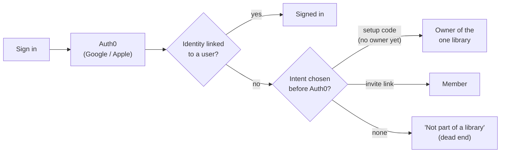
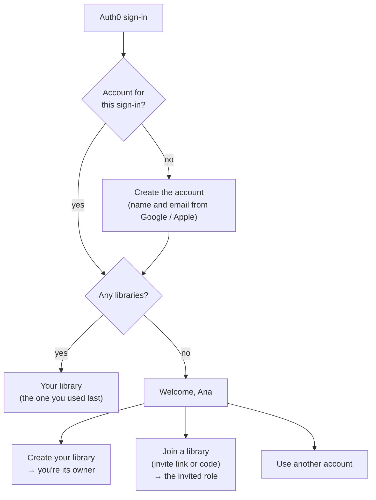

# 15 — New people: create a library or join one

**Status:** **Accepted**, 2026-10-23 (your answers are under [Decisions](#decisions)). The decision records are [ADR-026](12-decision-log.md#adr-026-onboarding-every-sign-in-is-an-account-people-create-or-join-libraries) and [ADR-027](12-decision-log.md#adr-027-a-multi-user-web-app-the-pc-is-only-a-development-host). Builders read [07](07-authentication-and-authorization.md) for how sign-in works today.

## What happened

At the Wave 6 cutover you pressed **Sign in**, chose Apple, and Auth0 signed you in. Then the app said "This account isn't part of a library". It was right by its own rules but wrong for you. You expected to be asked whether to **join a library or create your own**.

Answering the first draft of this plan, you also set the direction: CollectionMaxxing is **a normal web app with users**, like any other website. It will be hosted as a product later. The PC only hosts it while we build it, because that's free. So nobody owns "the server", and there's no server admin, setup code or server settings in the app (ADR-027).

## How it works today, and why it changes

- Today an Auth0 identity that isn't linked to one of our users gets nothing (ADR-025). The only ways in are an **intent chosen before Auth0**: the setup code (only while there's no owner), an invite link, adding a method while signed in, or a recovery code.
- The code assumes **one library per server**:
  - Setup creates it.
  - "The owner" means anyone with the Owner role (`IssueCode.OwnerExistsAsync`, `CompleteSignIn.FindOwnerAsync`).
  - There's no `POST /api/v1/libraries`.
  - The app opens your first membership (`useActiveLibraryId`), and there's no library switcher.
  - Removing a member from the library deletes their whole account (`users.deleted_at`).
- All of that goes. A person is an account, and an account can own and belong to several libraries.

## The new flow

**Sign in first, then decide.** There's one **Sign in** button everywhere. Your first sign-in creates your account. If you have no libraries yet, you land on **Welcome**:

| Choice | Who can use it | What happens |
|---|---|---|
| **Create your library** | Anyone signed in, up to **3 libraries they own** | A library and an Owner membership. You land in it. |
| **Join a library** | Anyone signed in, with a valid invite link or code | A membership with exactly the invited role (Editor or Viewer, never Owner). The invite is spent. |
| **Use another account** | Anyone | Signs out of Auth0 (`POST /account/logout` → `logoutUrl`), so the account picker shows again. |

- **Create and join stay available after Welcome:** "New library" and "Join a library" sit next to the library switcher.
- **Invite links keep working:** `/join/{token}` still previews the invite. Signed out, its button is **Sign in to join**, which comes back to the same page. Signed in, it's **Join**.
- **The setup page and the setup code go away.** No `/setup`, no "First time here?" button, no `secrets\setup-code.txt`.
- **Leaving and removing:** a member can leave a library, and an owner can remove a member. Either way only that membership ends. The account and its other libraries stay. A library's last owner can't leave it.
- **Recovery:** `docker exec collectionmaxxing-api-1 dotnet CollectionMaxxing.Api.dll --recovery-code <email>` stays as a host-side support tool for a named account, not an app role. The new sign-in it links goes to that account only. Everyone can also add Google and Apple to their own account in Settings.

### How the account is created

- **Web:** `/signin-oidc` with an identity it doesn't know creates the account inside one transaction: a user with the name and email from the ID token, plus the `user_logins` link. Then the normal `__Host-cm` session starts.
- **iPhone:** the first API call with a valid access token for an unknown `sub` creates the account the same way. The name and email come from Auth0's `/userinfo`, called once with that same token. They never come from the app's own word.
- **Nothing is matched by email.** A new `sub` is a new account, even if the email matches someone else's. Linking a second sign-in method to an account stays an explicit "Add a sign-in method" while signed in.
- Two first calls at once still create one account: the unique `user_logins (provider, sub)` index decides, and the loser reads the winner's row.

### Library switcher

- The web sidebar and iPhone Settings list your libraries with your role in each. The active one is remembered per device (the existing `activeLibraryId` store). With one library, the switcher doesn't show.
- **New library** and **Join a library** sit under the list.

### Invite codes

- A link is hard to move from a text message into the iPhone app. Each invite therefore also gets a **short code**: 10 Crockford base32 characters shown as `ABCD-EFGH-JK`, about 50 bits. It's shown once, when the invite is created, like the link.
- It has the same 7-day expiry, single use and revocation as the link, and only its hash is stored.
- Typing is forgiving: case and dashes don't matter, and `O`/`0` and `I`/`L`/`1` count as the same, as Crockford base32 allows.
- Previews and joins by code are rate-limited per account and per client. Unknown, expired, revoked and used invites all get the same answer.

## API contract (fixed here so web and iPhone can build against mocks)

| Route | Who | Request | Success | Problems |
|---|---|---|---|---|
| `GET /api/v1/libraries` *(exists)* | signed in | — | 200 `PageOfLibrarySummaryDto`, empty for a new account | — |
| `POST /api/v1/libraries` | signed in | `CreateLibraryRequest { name }` (1–80 chars, trimmed) | 201 `LibraryDto` with `role: Owner`, `Location: /api/v1/libraries/{id}` | 400 validation (`library.name_required`, `library.name_too_long`); 409 `library.limit_reached`; 429 |
| `POST /api/v1/invites:preview` | signed in | `InviteLookupRequest { invite }`: a link, a link token or a code | 200 `InvitePreviewDto` *(exists)* | 404 `invite.invalid`, the same for unknown, expired, revoked and used; 429 |
| `POST /api/v1/invites:accept` | signed in | `InviteLookupRequest { invite }` | 200 `LibrarySummaryDto` with the invited role | 404 `invite.invalid`; 409 `invite.already_member`; 429 |
| `DELETE /api/v1/libraries/{libraryId}/membership` | any member of that library | — | 204: you left | 409 `library.last_owner` |
| `POST /api/v1/libraries/{libraryId}/invites` *(exists)* | Owner | as today | 201 `CreatedInviteDto` gains **`code`** (`ABCD-EFGH-JK`) | as today |
| `DELETE /api/v1/libraries/{libraryId}/members/{userId}` *(exists)* | Owner | — | 204: ends that membership only; the account stays | as today |
| `GET /api/v1/invites/{token}` *(exists)* | anyone | — | 200 `InvitePreviewDto` | as today |

**Removed:**
- `GET /setup` and `POST /setup`, the setup-code purpose and the startup code that writes `setup-code.txt`;
- `GET /account/not-linked`, and the bearer 403 `account.not_linked`, because the first call creates the account;
- the `setup` and `join` intents on `/account/login`.

**Kept:** `/account/login?returnUrl=…`, the `link` intent ("Add a sign-in method"), `/account/logout` and `/account/recover`.

## Security

- **This is designed as a public website.** The tailnet is a development-time wall only. Every rule below has to hold with the app on the open internet (ADR-027).
- **Accounts:** anyone who completes an Auth0 sign-in gets an account, and an account with no libraries can reach only its own `/api/v1/me…` routes, the library list, create, and invite preview and accept. Every library route is still `RequireLibraryRole`.
- **Libraries are private to their members.** IDs from other libraries answer 404, as today.
- **Joining needs an invite.** Codes are about 50 bits, rate-limited and single use. An invite never grants Owner.
- **Limits:** 3 owned libraries per account (config `Libraries:MaxOwnedPerUser`, default 3). Per-account and per-client rate limits on create, preview and accept. Account creation is limited per client too.
- **Removal is immediate:** memberships are read on every request, so a removed member loses that library on their very next call.
- **Deleting an account** works as today: refused while a library they own has other members; otherwise their libraries go with them.

## Data model

| Change | Notes |
|---|---|
| `library_invites.code_hash` (nullable, unique) | For invite codes. Older invites keep working by link only. |
| Drop the setup-code purpose | The recovery-code purpose stays. |

There's no server admin flag and no server settings table. No data moves: the PC was wiped at the Wave 6 cutover, and its only account keeps its library if it already made one.

## What you see (copy follows [06](06-ux-and-wireframes.md#copy-rules))

- **Welcome, {name}.** "You're signed in with {Google/Apple} as {email}." **Create your library** · **Join a library** · **Use another account**
- **Create your library:** "Library name", prefilled "{name}'s library". Button: **Create library**. At the limit: "You already own 3 libraries, which is the most you can have."
- **Join a library:** "Paste the invite link or type the code you were sent." The preview, as today ("Join Cory's library as Editor"). Button: **Join**. Bad code: "That invite doesn't work. Ask for a new one."
- **Library switcher:** the library name with your role under it; **New library** and **Join a library** under the list.
- **Leave library** (Settings → Library, for non-owners): "You'll lose access to {library}. Your account stays."
- **Invite created:** the link, the QR code and "Or tell them this code: ABCD-EFGH-JK".

## Work breakdown (Wave 7)

| Task | Tier | Depends on | Scope |
|---|---|---|---|
| **ONB-0** | Lead + you | — | Your decisions; ADR-026 and ADR-027 accepted; briefs updated. |
| **ONB-1** | Critical, verifier | ONB-0 | API: accounts on first sign-in (web and bearer), `POST /libraries` with the limit, invite codes, preview and accept by link or code, leave, member removal that ends only the membership, the setup path removed, recovery by account, one migration, contract, matrix rows, and the locked tests below. Also the security and perf harness seeds (they used `/setup`). |
| **ONB-2** | Standard | the contract above | Web: `/welcome`; create and join; the library switcher with New and Join; leave; the invite code shown on create; `/join/{token}` signed in and out. Remove `/setup`, the "First time here?" button and the not-linked page. Jest + Playwright. |
| **ONB-3** | Standard | the contract above | iPhone: the native Welcome screen in place of the not-linked screen; create and join (with a code or a pasted link); the library switcher in Settings; leave. Jest; at most 3 `ios-check` runs. |
| **ONB-4** | Lead | All | Docs 00, 03, 04, 06, 07 and 10; release; your checkpoint. |

ONB-2 and ONB-3 start at the same time as ONB-1, against the contract above with MSW mocks.

**Locked acceptance tests for ONB-1:**
1. A first sign-in creates exactly one account and links its `sub`, through the web callback and through a bearer call. A second sign-in reuses it, and two first calls at once still make one. A new `sub` with an existing account's email gets a new account.
2. An account with no libraries gets 200 on `/api/v1/me` and an empty `GET /api/v1/libraries`, and 404 on another library's routes.
3. Any account can create a library and becomes its only Owner. Creating a fourth owned library is refused with 409 `library.limit_reached`. Another account can't see or reach it.
4. Joining by link or by code gives exactly the invited role, once, and never Owner. Unknown, expired, revoked and used invites fail the same way. Code lookups are rate-limited.
5. Removing a member or leaving ends that membership on the next request. The account and its other libraries stay, and the last owner can't leave.
6. The setup routes are gone. The recovery code links a new identity to the named account only.
7. The authorization matrix covers "signed in, no libraries" and every new route.

## Decisions

Your answers on 2026-10-23:

| | Question | Answer |
|---|---|---|
| **D-1** | Who may create a library? | **Anyone who signs in.** |
| **D-2** | Does the first library need the setup code? | **No setup code at all.** It's a normal web app with users. The PC is only a cheap development host, and the product will be hosted later (ADR-027). |
| **D-3** | How many libraries may one person create? | **3.** It's a config value, not a setting in the app. |
| **D-4** | Short invite codes as well as links? | **Yes.** |
| **D-5** | "Ask to join" requests? | **Not now.** |
| **D-6** | What can a server admin see? | **Doesn't apply:** there's no server admin. |
| **D-7** | When is an account created? | **On first sign-in.** |

## Not doing

- Matching people by email.
- A server admin, an operator console, or server settings in the app.
- Deleting a library, and transferring ownership. Account deletion still takes the libraries you own alone. Both are follow-ups if libraries multiply.
- Moving items between libraries.
- Moving off the PC. Hosting the product is a later decision, with its own cost (ADR-027).
