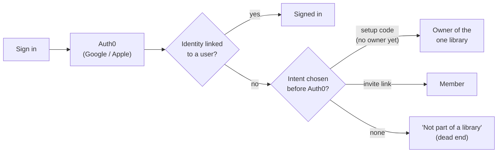
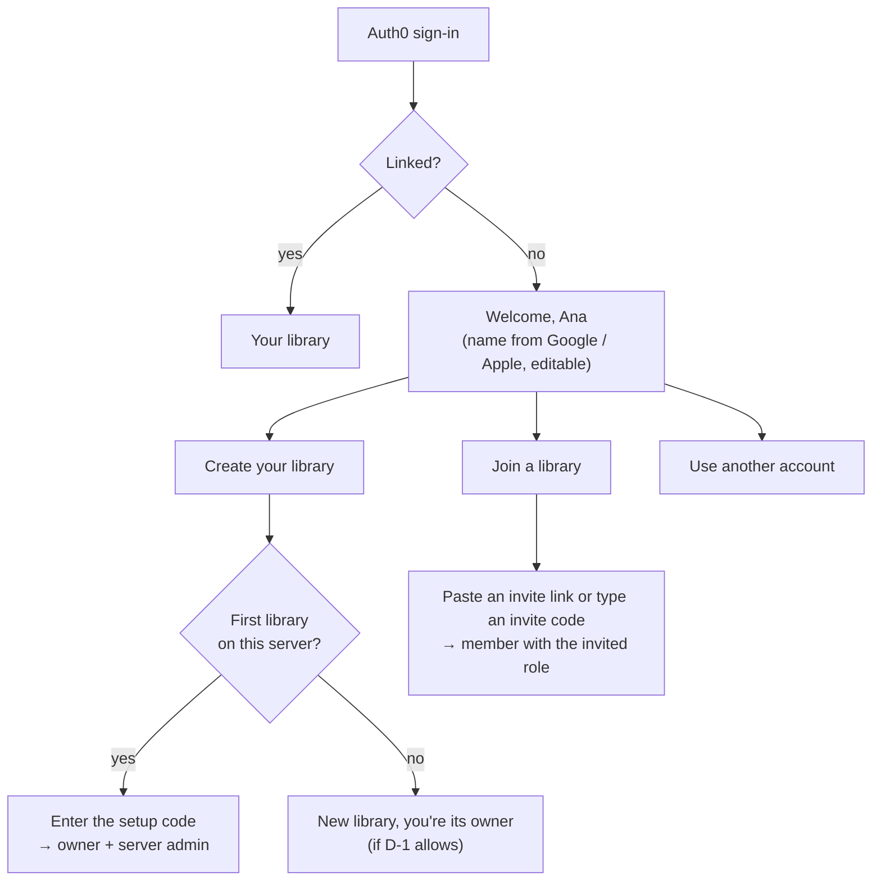

# 15 — New people: create a library or join one (plan)

**Status:** **Proposed**, 2026-10-23. It needs your answers to [D-1 to D-6](#decisions-for-you) before Wave 7 starts. The decision record is [ADR-026](12-decision-log.md#adr-026-onboarding-create-a-library-or-join-one). Builders read [07](07-authentication-and-authorization.md) for how sign-in works today.

## What happened

At the Wave 6 cutover you pressed **Sign in**, chose Apple, and Auth0 signed you in. Then the app said "This account isn't part of a library". It was right by its own rules but wrong for you. You expected to be asked whether to **join a library or create your own**.

## How it works today, and why

- An Auth0 identity that isn't linked to one of our users gets nothing (ADR-025). Anyone can open your Auth0 sign-in page and create an identity. The tailnet is the outer wall, and linking is the inner one.
- The only ways in are an **intent chosen before Auth0**: the setup code (only while there's no owner), an invite link, adding a method while signed in, or a recovery code.
- So you have to know which button to press **before** you sign in. "First time here? Set up CollectionMaxxing" is a separate button under **Sign in**, and the plain button can never create anything.
- The rest of the system assumes **one library per server** (docs/00 "one shared library for your household"):
  - Setup creates it.
  - "The owner" means anyone with the Owner role (`IssueCode.OwnerExistsAsync`, `CompleteSignIn.FindOwnerAsync`).
  - There's no `POST /api/v1/libraries`.
  - The app always opens your first membership (`useActiveLibraryId`), and there's no library switcher.
- The iPhone has the same dead end: an unlinked bearer token gets 403 `account.not_linked` and the not-linked screen.

## Proposed flow

**Sign in first, then decide.** There's one **Sign in** button everywhere. After Auth0, a linked identity goes straight in. An identity that isn't linked lands on a **Welcome** page instead of a dead end:

| Choice | Who can use it | What happens |
|---|---|---|
| **Create your library** | First run: whoever has the setup code. Afterwards: depends on **D-1**. | A user, a library and an Owner membership are created, the identity is linked, and you're signed in. The first one on a server also makes you **server admin**. |
| **Join a library** | Anyone with a valid invite link or code | As today's invite path: a user and a membership with exactly the invited role. The invite is spent. |
| **Use another account** | Anyone | Signs out of Auth0 (`POST /account/logout` → `logoutUrl`) so the account picker shows again. |

**Invite links keep working.** `/join/{token}` still previews the invite and offers **Sign in to join**. That path skips the Welcome page.

**The setup page goes away.** The setup code becomes a field under "Create your library" on a fresh install. `secrets\setup-code.txt` and `cm-admin recovery-code` stay as they are.

### How the Welcome page knows who you are

**Web:**
- `/signin-oidc` with an unlinked identity creates no user. It sets a short-lived, Data Protection–sealed **pending-identity cookie** (`__Host-cm-pending`, 15 minutes, HttpOnly) holding the verified `sub`, email, name and `auth_time`, then redirects to `/welcome`.
- The Welcome page's create and join calls read that cookie. There's no second Auth0 round trip and no intent to choose in advance.
- The cookie is never a session: it unlocks only the onboarding endpoints.

**iPhone:**
- The app already holds a valid Auth0 access token. A new `Unlinked` authorization policy accepts a validated bearer token whose `sub` isn't linked, but **only** on the onboarding endpoints.
- Every other endpoint still answers 403 `account.not_linked`.
- The native Welcome screen calls the same endpoints.

**Endpoints:**

| Route | Who | Does |
|---|---|---|
| `GET /api/v1/onboarding` | pending identity (cookie or bearer) | Name and email to prefill. Whether a library may be created (`setupCodeRequired`, `selfServiceAllowed`). |
| `POST /api/v1/onboarding/library {libraryName, displayName, setupCode?}` | pending identity | Creates the user, library, Owner membership and link in one transaction. The first library also needs the setup code and makes the server admin. |
| `POST /api/v1/onboarding/join {invite, displayName}` | pending identity | `invite` is a link token or a short code. Same rules as today's invite acceptance. |

On the web the two POSTs end the pending cookie and start the normal `__Host-cm` session. On the iPhone the app simply carries on with its token.

### Libraries, owners and the server admin

If D-1 lets people create their own libraries, "the owner" stops meaning one person. So the plan separates two roles:

- **Library owner:** as today, per library. Invites, member roles, library settings and deleting the library.
- **Server admin:** a flag on one user (`users.is_server_admin`), set by the first library created with the setup code.
  - The recovery code links a new identity to **the server admin**, no longer "the owner".
  - Server settings (D-1's switch, D-3's limit) belong to the server admin.
  - The server admin can't see inside libraries they're not a member of (**D-6**).
- **Library switcher:** the web sidebar and iPhone Settings list your memberships. The active one is remembered per device (the existing `activeLibraryId` store). With one library nothing changes on screen.
- **Owner-only code paths** (`OwnerExistsAsync`, `FindOwnerAsync`, setup's "only while no owner") move to "server admin exists".

### Invite codes (D-4)

- A link is hard to move from a text message to the iPhone app. Each invite therefore also gets a **short code**: 10 Crockford base32 characters shown as `ABCD-EFGH-JK`, about 50 bits.
- It has the same 7-day expiry, single use and revocation as the link, and only its hash is stored.
- Lookups are rate-limited per client like the setup code. Wrong codes are counted, and a client is never told whether a code exists but has expired.

## Security

- **Who can reach the Welcome page:** only someone who reached the app (your tailnet) and completed an Auth0 sign-in. The tailnet stays the outer wall. With D-1 = "anyone", a tailnet guest who signs in can create **their own empty library**, never see yours.
- **Nothing is matched by email:** as today. Joining needs an invite, and the first library needs the setup code.
- **The pending cookie** is sealed, short-lived and bound to the `sub` Auth0 vouched for. It can't be replayed into a session: only the create and join calls accept it, and each one checks the identity is still unlinked inside its transaction.
- **The `Unlinked` bearer policy** covers three routes. The authorization matrix gets an "unlinked identity" actor: 200 on the onboarding routes and 403 everywhere else.
- **Limits:**
  - per-client rate limits on create, join and code lookups;
  - D-3's cap on libraries per person;
  - library and display names validated like today's.
- **Locked tests carry over:** the unlinked tests change from "nothing happens" to "only onboarding works". The setup code still works once, only while there's no server admin. An invite gives exactly its role, and never Owner.

## Data model

| Change | Notes |
|---|---|
| `users.is_server_admin` (bool, at most one true: a partial unique index) | Set by the first library's creation. Existing installs set it on the current owner in the migration. |
| `library_invites.code_hash` (nullable, unique) | For D-4. Old invites keep working by link only. |
| `server_settings` (single row: `self_service_libraries`, `max_libraries_per_user`) | For D-1 and D-3. Edited by the server admin in Settings. |

No data moves: the server was wiped at the Wave 6 cutover, and its only user is about to be the owner.

## What you see (copy follows [06](06-ux-and-wireframes.md#copy-rules))

- **Welcome, {name}.** "You're signed in with {Google/Apple} as {email}." **Create your library** · **Join a library** · **Use another account**
- **Create your library:** "Library name", prefilled "{name}'s library". On a fresh install it also asks for the "Setup code", with the hint "It's in `secrets\setup-code.txt` on the PC". Button: **Create library**.
- **Join a library:** "Paste the invite link or type the code you were sent." The preview, as today ("Join Cory's library as Editor"). Button: **Join**.
- **When D-1 doesn't allow creating:** the create card says "Ask {server admin} for an invite. Only they can add libraries here."

## Work breakdown (Wave 7)

| Task | Tier | Depends on | Scope |
|---|---|---|---|
| **ONB-0** | Lead + you | — | Your answers to D-1 to D-6. ADR-026 accepted. Briefs updated. |
| **ONB-1** | Critical, verifier | ONB-0 | API: the pending-identity cookie, the `Unlinked` bearer policy, the three onboarding routes, server admin, invite codes, `server_settings`, one migration, matrix rows, and locked tests (below). The `/setup` routes go away. |
| **ONB-2** | Standard | ONB-1 contract | Web: `/welcome` with create and join, invite code entry, the library switcher, server settings for the admin. Remove `/setup` and the "First time here?" button. Playwright journeys. |
| **ONB-3** | Standard | ONB-1 contract | iPhone: the native Welcome screen in place of the not-linked screen, create and join, the library switcher in Settings. Jest; at most 3 `ios-check` runs. |
| **ONB-4** | Lead | All | Docs 00, 03, 04, 06, 07; release; your checkpoint. |

The routes are fixed in ONB-1's brief, so ONB-2 and ONB-3 can start against MSW mocks at the same time. Two Wave 6 follow-ups are worth doing first:
- **#246:** the deployer starts a release with the previous release's compose file. This plan changes nothing there, but the next compose change would trip it again.
- **#242:** the security and perf harnesses sign in through a fake Auth0. They can't test onboarding without it.

**Locked acceptance tests for ONB-1:**
1. An unlinked identity reaches only the onboarding routes (cookie and bearer). Everything else is 403 `account.not_linked`, and no user row exists until create or join succeeds.
2. On a fresh server, creating a library needs the setup code, works once, and makes exactly one server admin.
3. With self-service on (D-1), a second person can create their own library and can't see the first one. With it off, they get 403 and a clear problem code.
4. Joining with a link or a code gives exactly the invited role, once. Expired, revoked and used invites fail the same way.
5. The pending cookie is refused after 15 minutes, after a create or join, from another browser, and when tampered with.
6. The recovery code links a new identity to the server admin only.
7. The authorization matrix covers the unlinked actor and every new route.

## Decisions for you

| | Question | Recommendation |
|---|---|---|
| **D-1** | After setup, who may **create** a library? | **Anyone who can reach the app and signs in.** Your tailnet already limits who that is, and a new library is empty and private. The server admin can turn it off in Settings. The alternatives: only people the server admin invites to create one, or nobody (one library per server, as v1). |
| **D-2** | Does the **first** library still need the setup code? | **Yes.** It proves the person has the PC, and it decides who becomes server admin. Without it, whoever signs in first on a fresh install takes the server. |
| **D-3** | How many libraries may one person create? | **3.** Enough for "mine" plus a shared one, low enough that a mistake can't fill the disk. The server admin can change it. |
| **D-4** | Short invite codes as well as links? | **Yes.** They're easier to type on a phone, with the same rules as links. |
| **D-5** | "Ask to join" requests that an owner approves, for people without an invite? | **Not now.** Invites cover it. Later, if family keeps asking. |
| **D-6** | Can the server admin see libraries they're not a member of? | **No**, only their names and sizes in server settings, for housekeeping. Privacy stays per library. |

## Right now, before Wave 7

You can still get in today:
1. Sign out.
2. Choose **"First time here? Set up CollectionMaxxing"** and enter the code from `C:\CollectionMaxxing\secrets\setup-code.txt`.
3. Sign in with Apple again. Your Apple identity becomes the owner, and Wave 7 keeps it as the server admin.

## Not doing

- Matching people by email, or creating users for identities that didn't choose create or join.
- Public sign-up from outside the tailnet. The PC stays private.
- Moving items between libraries (a later wave, if libraries multiply).
